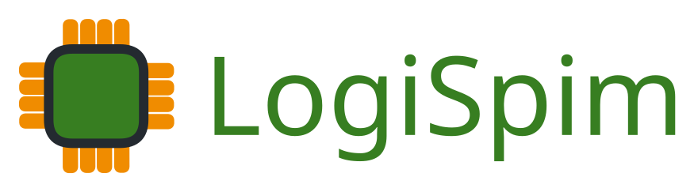

    <picture>
      <source media="(prefers-color-scheme: dark)" srcset="./assets/logo/LogiSpim_Logo_Light.svg">
      <source media="(prefers-color-scheme: light)" srcset="./assets/logo/LogiSpim_Logo_Dark.svg">
      
    </picture>

___

This project is currently under construction.
Expected initial release is estimated for during Fall Semester of 2026.

Prerelease versions are available [here](https://github.com/henrygucker/LogiSpim/releases).
Documentation pertaining to the prerelease version of LogiSpim is under development.

Additional information & documentation page can be found [here](https://henrygucker.github.io/LogiSpim/).
