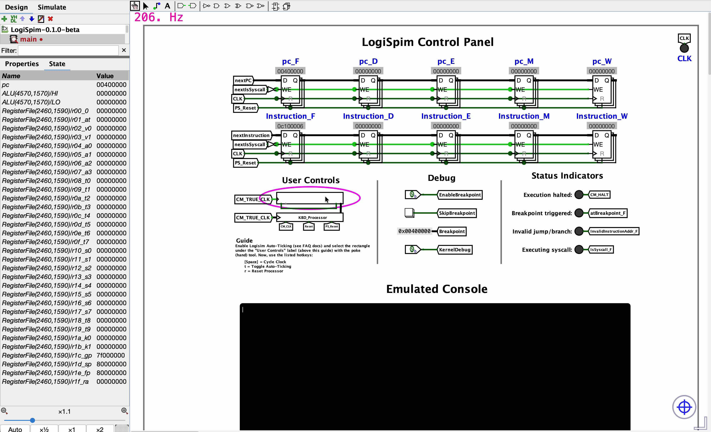
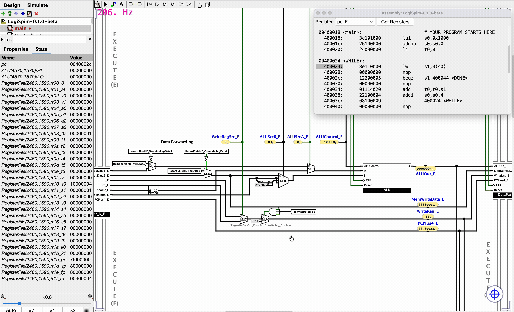
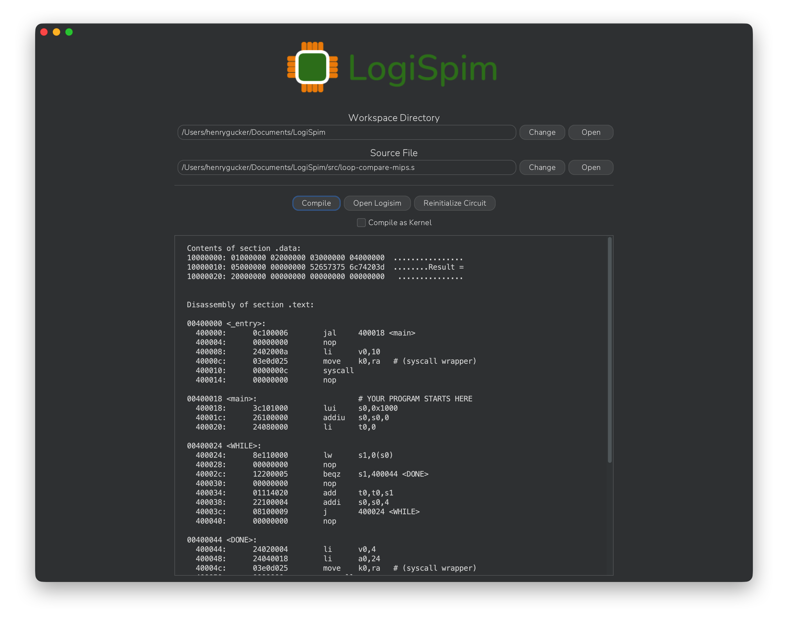

    <picture>
      <source media="(prefers-color-scheme: dark)" srcset="./assets/logo/LogiSpim_Logo_Light.svg">
      <source media="(prefers-color-scheme: light)" srcset="./assets/logo/LogiSpim_Logo_Dark.svg">
      
    </picture>

___

## Summary

**LogiSpim** interactively teaches pipelined MIPS microarchitecture through exploration of its pipelined 32-bit MIPS
processor built in [Logisim-evolution](https://github.com/logisim-evolution/logisim-evolution).
By running their own MIPS programs on the processor, students engage with the digital logic performing its
instructions in every step.

## Processor Features
* User-friendly clock and reset controls supporting step, auto-tick, and reset operations with keybinds
* Visual displays of pipeline state over time, depicting instruction motion through pipeline
* Syscall support for printing and exiting from programs through a lightweight kernel
* Built-in breakpoints for debugging
* Displays current register values and program assembly within Logisim-evolution

*See the GIFs below to watch some of these features in action!*

### Printing
Printing to the emulated console through syscalls:

### Clock Stepping & Assembly Viewer
Manually stepping through instructions while zoomed into the processor's Execute stage with the Assembly Viewer open:

## LogiSpim Application
The LogiSpim application enables users to run their own programs on LogiSpim's processor.
More information about the application, its role in the LogiSpim project, and installation guides can be
found [here](https://henrygucker.github.io/LogiSpim/02_what_is_logispim/01_app.html).

## Documentation
Documentation for LogiSpim can be found on the [documentation page](https://henrygucker.github.io/LogiSpim/), including
installation & setup guides.

___

## Additional Resources
The microarchitecture of LogiSpim's processor was based primarily on [this textbook and its companion assets](https://shop.elsevier.com/books/book-companion/9780124077263),
notably with the instruction set based on its [MIPS reference card](https://booksite.elsevier.com/9780124077263/downloads/COD_5e_Greencard.pdf).
