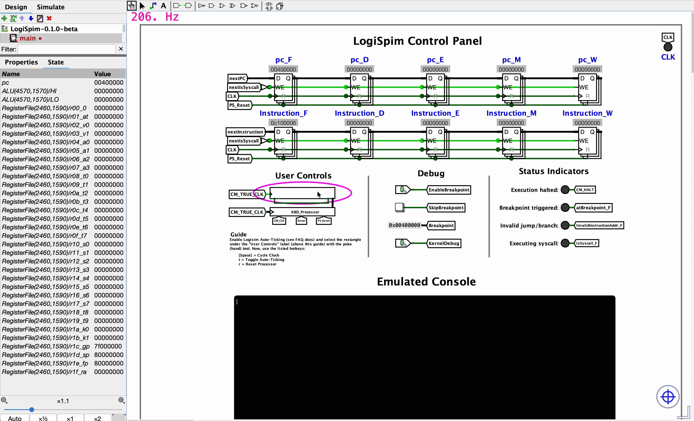
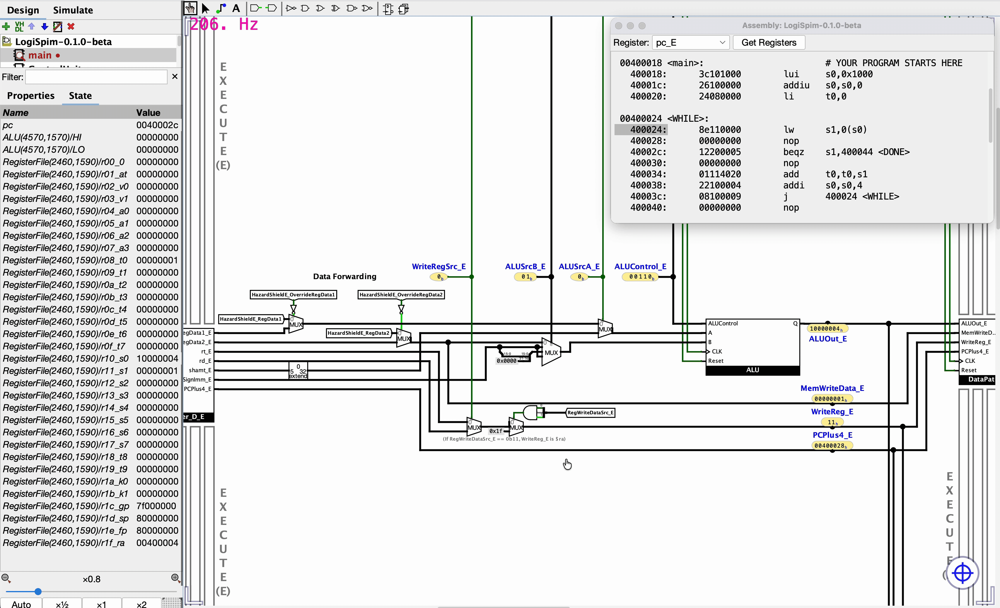
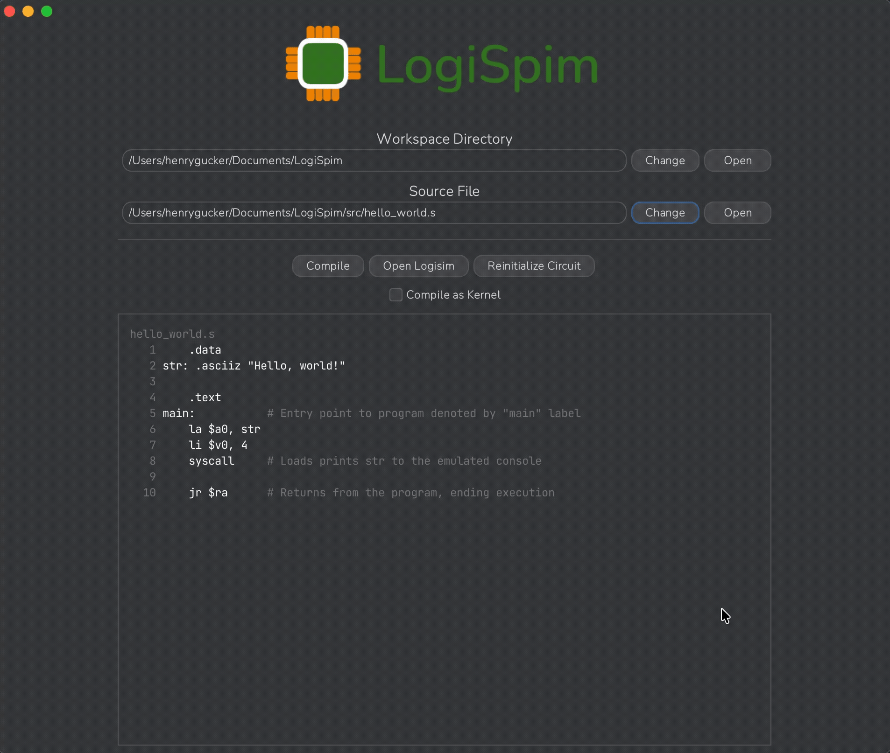
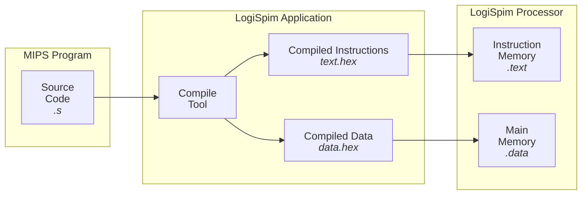

v1.0.0

    <picture>
      <source media="(prefers-color-scheme: dark)" srcset="assets/LogiSpim_Logo_Light.svg">
      <source media="(prefers-color-scheme: light)" srcset="assets/LogiSpim_Logo_Dark.svg">
      
    </picture>

[Overview][Get Started] | [Installation Guide] | [Usage Guide] | [FAQ][FAQ Page]

[Get Started]: https://henrygucker.github.io/LogiSpim/02_what_is_logispim/index.html
[Installation Guide]: https://henrygucker.github.io/LogiSpim/03_installation/index.html
[Usage Guide]: https://henrygucker.github.io/LogiSpim/04_usage_guide/index.html
[FAQ Page]: https://henrygucker.github.io/LogiSpim/05_faq/index.html

___

## Summary

**LogiSpim** interactively teaches pipelined MIPS microarchitecture through exploration of its pipelined 32-bit MIPS
processor built in [Logisim-evolution](https://github.com/logisim-evolution/logisim-evolution).
By running their own MIPS programs on the processor, students engage with the digital logic performing its
instructions in every step.

## Processor Features

* User-friendly clock and reset controls supporting step, auto-tick, and reset operations with keybinds
* Visual displays of pipeline state over time, depicting instruction motion through pipeline
* Syscall support for printing and exiting from programs through a lightweight kernel
* Built-in breakpoints for debugging
* Displays current register values and program assembly within Logisim-evolution

### Showcase

    
<h4 style="display: inline; margin: 0">Printing & Register Viewer</h4>

Printing to the emulated console through syscalls with the register view shown on the left:

    
<h4 style="display: inline; margin: 0">Clock Stepping & Assembly Viewer</h4>

Manually stepping through instructions while zoomed into the processor's execute stage with the Assembly Viewer open:

## LogiSpim Application
The LogiSpim application enables users to run their own programs on LogiSpim's processor through some
utilities:
* Automated compilation and processing of source code
* Disassembly view with interleaved source code
* Integrated Logisim-evolution controls and circuit management

More information about the application and its role in the LogiSpim project, 
look [here](../02_what_is_logispim/index.md#logispims-novelty).

### Showcase

    
<h4 style="display: inline; margin: 0">Compilation with Disassembly View</h4>

Compiling a MIPS program and viewing the disassembly, while processed binary files prepare for import to Logisim-evolution:

    
<h4 style="display: inline; margin: 0">LogiSpim Application Workflow</h4>

To streamline the compilation and loading process, the LogiSpim application compiles MIPS source code into files which can be easily
imported into the LogiSpim processor.

The described workflow is pictured below:

## Installation and Usage
Guides for installing and using LogiSpim are linked below:
* [Installation Guide]
* [Usage Guide]

## Additional Resources
The microarchitecture of LogiSpim's processor was based primarily on [this textbook and its companion assets](https://shop.elsevier.com/books/book-companion/9780124077263),
notably with the instruction set based on its [MIPS reference card](https://brand.elsevier.com/share/6aARqA6Vi7mcaoV8DWQs/assets/98319).
