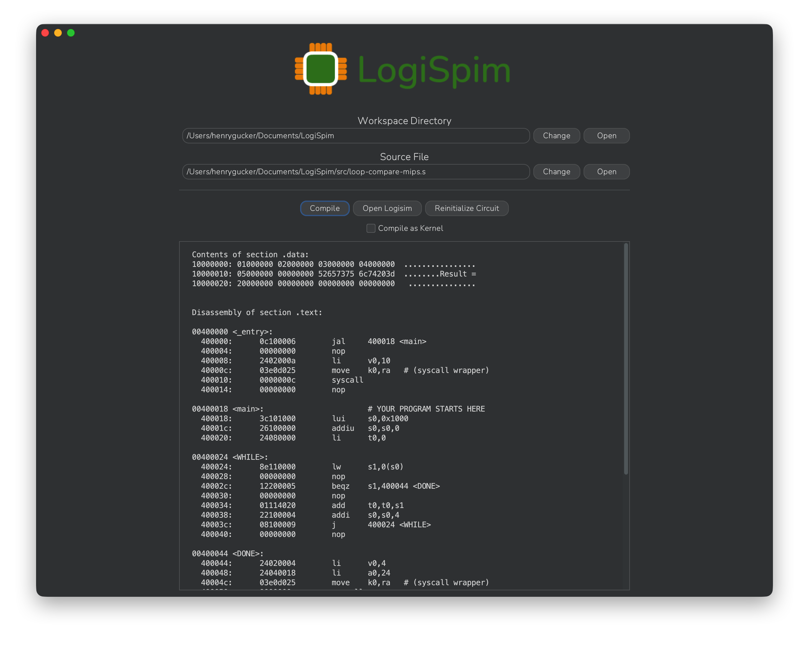

# The LogiSpim Application

## Summary

Aiming to simplify the workflow for running programs on the LogiSpim processor, the LogiSpim application
provides an assortment of utilities for downloading and using the own LogiSpim processor.

## Features
 - Automated compilation of MIPS source code for import into Logisim-evolution
 - Handler for downloading, restoring, and opening the LogiSpim processor
 - Convenient organization of LogiSpim files and workspaces
 - Disassembly display after compilation to easily follow execution flow and obtain breakpoint addresses

## Installation & Usage
Supported on all major operating systems, the app can be easily installed by following the
[installation guide](../03_installation/index.md).

After installing the app, follow the [usage guide](../04_usage_guide/index.md) to run
your first program on the LogiSpim processor.