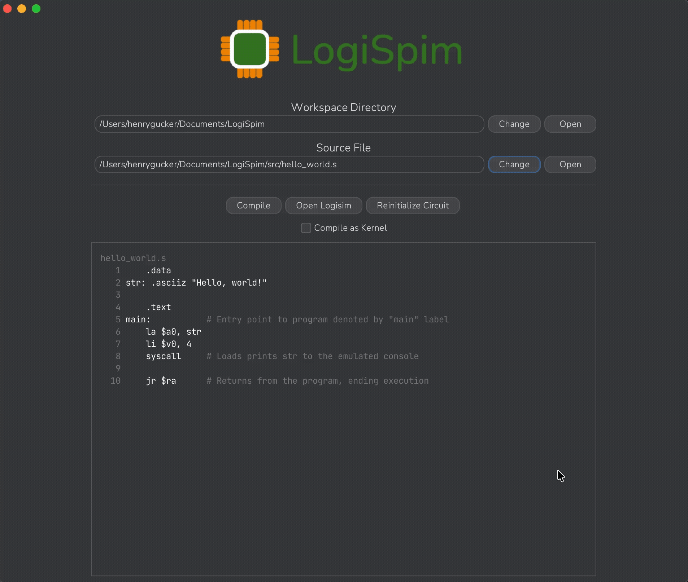

# The LogiSpim Application

## Summary

Aiming to simplify the workflow for running programs on the LogiSpim processor, the LogiSpim application
provides an assortment of utilities for downloading and using the own LogiSpim processor.

## Features
 - Automated compilation of MIPS source code for import into Logisim-evolution
 - Disassembly display after compilation to easily follow execution flow and obtain breakpoint addresses
 - Handler for downloading, restoring, and opening the LogiSpim processor
 - Convenient organization of LogiSpim files and workspaces

