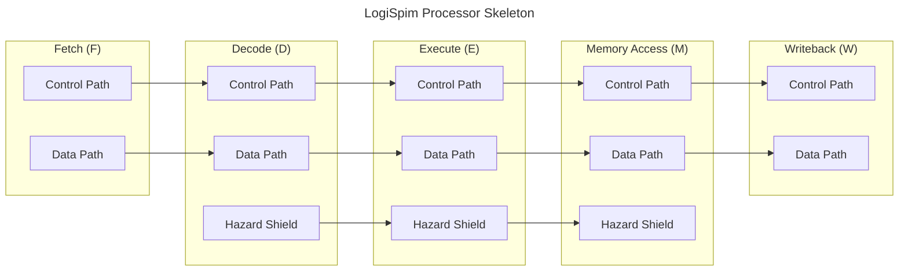
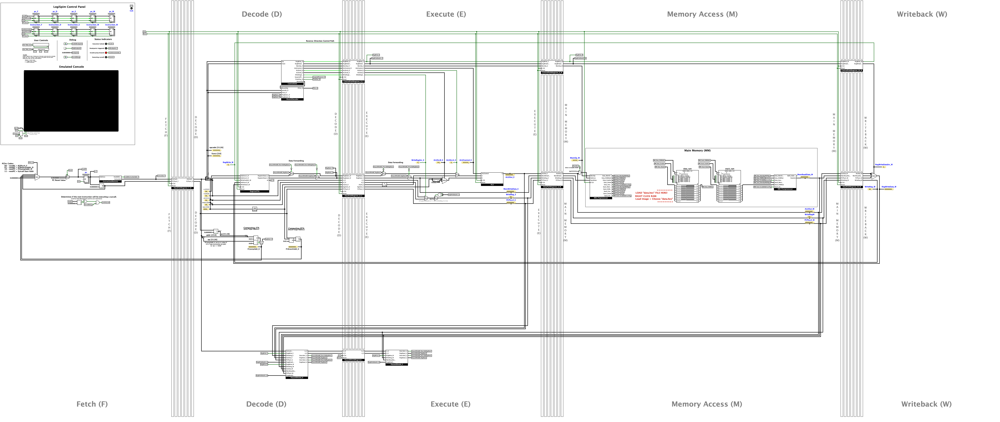
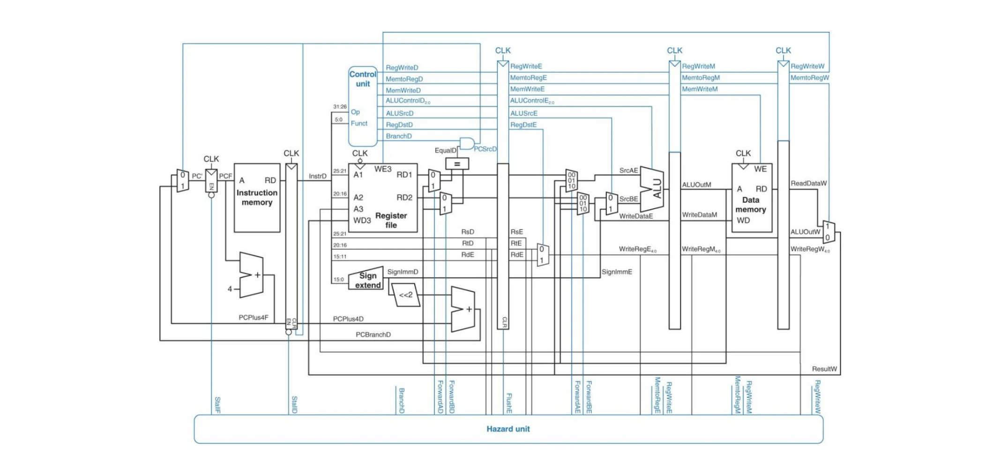

# The LogiSpim Processor

## Summary
The LogiSpim processor, a pipelined 32-bit MIPS processor implements most MIPS instructions,
including syscalls for printing
output directly within Logisim-evolution. In doing so, the processor grants an interactive view into the functions of
a pipelined processor, allowing for in-depth analysis at any state.

## Features
* User-friendly clock and reset controls supporting step, auto-tick, and reset operations with keybinds
* Visual displays of pipeline state over time, depicting instruction motion through pipeline
* Syscall support for printing and exiting from programs through a lightweight kernel
* Built-in breakpoints for debugging
* Displays current register values and program assembly within Logisim-evolution

## Understanding the Processor
*If you don't understand pipelining, see the [FAQ](../05_faq/02_processor_faq/index.md) page for an explanation before
reading the rest of this section.*

The LogiSpim processor main circuit appears complicated on first glance.

Thankfully, there are some great ways to break the processor down:
1. Separating pipeline stages 
2. Separating the control path, the data path, and the hazard shield

The following chart does both; each colored box corresponds to a pipeline stage, and inside each stage is its
control path, data path, and hazard shield placed similarly to how they appear in the processor itself.

Since this chart mirrors the processor's layout, it is relatively clear what each part of the processor is while
zoomed out.

If you look closer, you can see how the pipeline stages are labeled and separated by vertical bars.
The control path, data path, and hazard shield run horizontally across pipeline stages and have gaps separating them.

For those familiar with the textbook *Computer Organization and Design: The Hardware/Software Interface, 5th Edition*
by David A. Patterson & John L. Hennessy (2013),
you may recognize the following architecture from [these lecture slides](https://brand.elsevier.com/share/Nw4aT7pHm3zpyKU2ytHD/assets/97144).

The LogiSpim processor follows a similar structure, but implements more instructions.

*In the case that you are not familiar with the architecture shown, it is highly encouraged for you to look at the slides
linked above.*