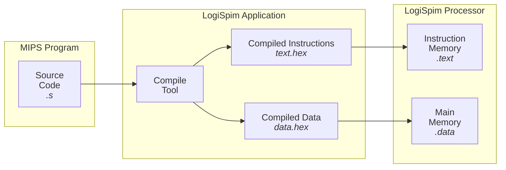

# What is LogiSpim?

The LogiSpim project interactively teaches students pipelined microarchitecture through exploring a simulated [MIPS processor](02_logispim_processor.md).

By immersing students in an implementation of MIPS microarchitecture, LogiSpim encourages its users to build a deeper
understanding of computer architecture (and some operating systems concepts). Moreover, students who learn LogiSpim's
implementation can contribute to the project, helping future students while gaining open-source contribution experience. 

## LogiSpim's Novelty
As part of LogiSpim's interactive mission, the project aims to let users run their own MIPS programs on the LogiSpim
processor;
however, this behavior is not supported directly by Logisim-evolution.

To enable this behavior, LogiSpim includes [an application](01_logispim_app.md) dedicated to streamlining the compilation and loading process.
On a high-level, the LogiSpim application compiles MIPS source code into files which can be easily
imported into the LogiSpim processor.

The described workflow is pictured below:

The following sections provide overviews of the project's key components:
 - [The LogiSpim Application](01_logispim_app.md)
 - [The LogiSpim Processor](02_logispim_processor.md)
