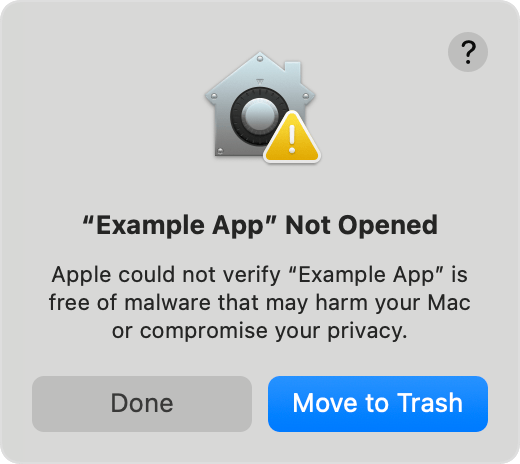

# LogiSpim Installation Guide for macOS (Apple Silicon)

## 1. Install Logisim-evolution (v5.0.0+)
To function correctly, LogiSpim requires Logisim-evolution v5.0.0+ to be installed as an application
(not just a downloaded JAR).

To install Logisim-evolution, download and run the most recent `...-aarch64.dmg` installer from the
[releases page](https://github.com/logisim-evolution/logisim-evolution/releases).
For your convenience, [this](https://github.com/logisim-evolution/logisim-evolution/releases/download/v5.0.0/logisim-evolution-5.0.0-aarch64.dmg)
is a direct link to download the v5.0.0 installer for devices with Apple Silicon processors.

> [!TIP]
> 
 
<h4 style="display: inline; margin: 0;">Is macOS not letting you launch the installer?</h4>
  
> Since the Logisim-evolution app is not signed with an Apple approved certificate, recent macOS versions display a
> warning and only prompt users with two options: <code>Move to Trash</code> and <code>Done</code> as pictured below: 
>  
> To launch the installer, you must open the <code>System Settings</code> app.
> Inside the app, navigate to the <code>Privacy & Security</code> tab. Then, scroll down to the <code>Security</code> section
> where there should be an option to launch the app as pictured below: 
> 

## 2. Install LogiSpim

To install LogiSpim, download the most recent `...-macos-aarch64.dmg` installer from 
LogiSpim's [releases page](https://github.com/henrygucker/LogiSpim/releases).

> [!TIP]
> Since the LogiSpim app is also not signed with an Apple approved certificate, you may need to follow the guide in the
> previous tip to open the LogiSpim installer as well.

## 3. Installation Complete
Your installation is now complete, and you should be able to launch the LogiSpim app!

Move on to the [usage guide](../../04_usage_guide/index.md) to run your first program on the LogiSpim
processor!

