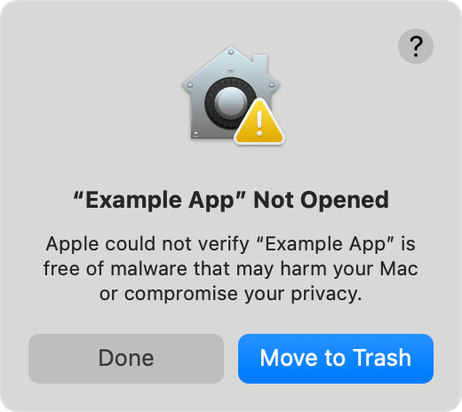
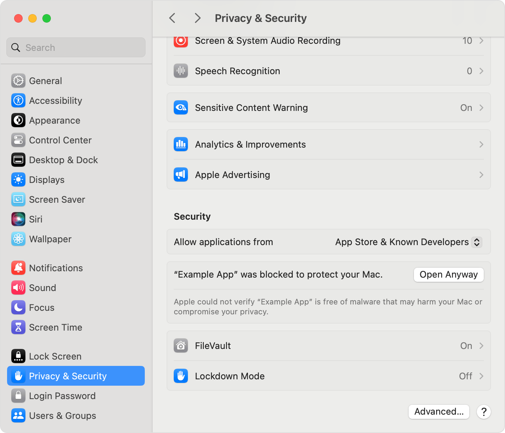
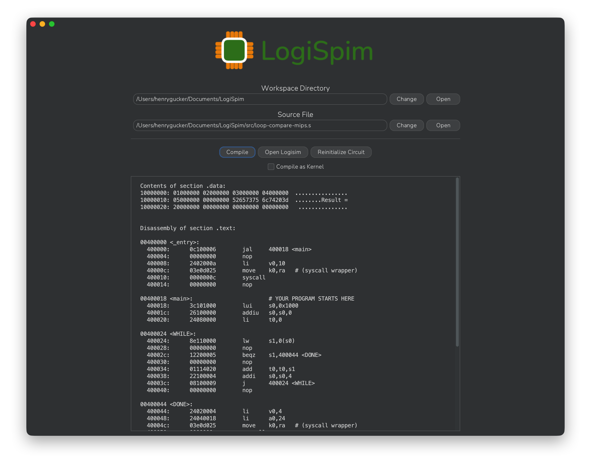

# LogiSpim Installation Guide for macOS

## 1. Install Cross-Compilation Toolchain
To compile MIPS code into binary form on macOS, a dedicated toolchain is required.

On macOS, installation of the MIPS cross compilation toolchain from [this repository](https://github.com/messense/homebrew-macos-cross-toolchains)
is supported by the LogiSpim app.
As outlined in the linked repository's `README.md`, installation through [Homebrew](https://brew.sh) (`brew`) is straightforward.

With [Homebrew](https://brew.sh) installed, the `mipsel-unknown-linux-gnu` toolchain can be installed as follows:
1. Allow Homebrew to access the packages hosted by the repository.
```shell
brew tap messense/macos-cross-toolchains
```
2. Install the cross-compilation toolchain package.
```shell
brew install mipsel-unknown-linux-gnu
```

> [!NOTE]
> *Installing precompiled toolchains through the repository's [Github releases](https://github.com/messense/homebrew-macos-cross-toolchains/releases) is
> an alternative option.*


## 2. Install Logisim-evolution (v5.0.0+)
To function correctly, LogiSpim requires a Logisim-evolution version of at least v5.0.0 to be installed.

To install Logisim-evolution, download and run the most recent `...-aarch64.dmg` installer from the
[releases page](https://github.com/logisim-evolution/logisim-evolution/releases).
For your convenience, [this](https://github.com/logisim-evolution/logisim-evolution/releases/download/v5.0.0/logisim-evolution-5.0.0-aarch64.dmg)
is a direct link to download the v5.0.0 installer for devices with Apple Silicon processors.

Logisim-evolution must be installed as an application (rather than a JAR) for LogiSpim to open the processor
automatically through the `Open Logisim` button.

> [!TIP]
> Since the Logisim-evolution app is not signed with an Apple approved certificate, recent macOS versions display a
> warning and only prompt users with two options: `Move to Trash` and `Done` as pictured below:<br/>
> <br/>
> To launch the installer, you must open the `System Settings` app.
> Inside the app, navigate to the `Privacy & Security` tab. Then, scroll down to the `Security` section
> where there should be an option to launch the app as pictured below:<br/>
> 

## 3. Install LogiSpim

To install LogiSpim, download the most recent `...-macos-aarch64.dmg` installer from 
LogiSpim's [releases page](https://github.com/henrygucker/LogiSpim/releases).

> [!TIP]
> Since the LogiSpim app is also not signed with an Apple approved certificate, you may need to follow the guide in the
> previous tip to open the LogiSpim installer as well.

## 4. Installation Complete
Your installation is now complete, and you should be able to launch the LogiSpim app!
When you first launch the app, it will automatically place the LogiSpim processor `.circ`
file in your LogiSpim workspace directory.

Move on to the [usage guide](../../04_usage_guide/index.md) to run your first program on the LogiSpim
processor!



