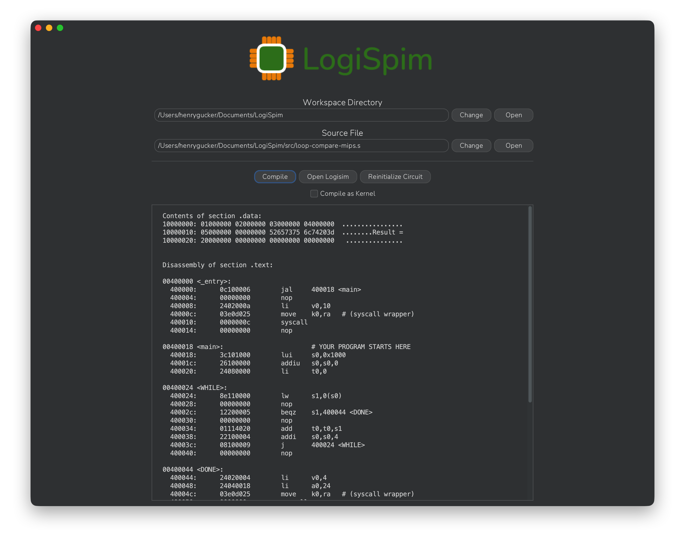

# LogiSpim Installation Guide for Windows

## 1. Install Cross-Compilation Toolchain
To compile MIPS code into binary form on Windows, a dedicated toolchain is required.

Since Windows lacks a native cross-compilation toolchains, Windows Subsystem for Linux (WSL) must be used.

Steps for installation on Windows are as follows:
1. Follow [this guide](https://learn.microsoft.com/en-us/windows/wsl/install) for installing WSL 1 (`wsl`).
   * If you already have WSL 1 installed, ensure that a Debian-based distribution (such as Ubuntu) is installed.
   * Ensure you install WSL 1 (`wsl`) and not WSL 2 (`wsl2`) as LogiSpim is configured to target WSL 1.
2. From a PowerShell instance opened as Administrator, run the following command to update WSL's local package index.
```shell
wsl sudo apt update
```
3. From this same PowerShell instance, run the following command to install the cross-compilation toolchain package on the WSL instance.
```shell
wsl sudo apt install binutils-mipsel-linux-gnu
```


## 2. Install Logisim-evolution (v5.0.0+)
To function correctly, LogiSpim requires a Logisim-evolution version of at least v5.0.0 to be installed.

To install Logisim-evolution, download and run the most recent `...-windows-amd64.exe` installer from the 
[releases page](https://github.com/logisim-evolution/logisim-evolution/releases).
For your convenience, [this](https://github.com/logisim-evolution/logisim-evolution/releases/download/v5.0.0/logisim-evolution-5.0.0-windows-amd64.zip)
is a direct link to download the v5.0.0 installer.

Logisim-evolution must be installed as an application (rather than a JAR) for LogiSpim to open the processor
automatically through the `Open Logisim` button.

> [!NOTE]
> Currently, Logisim-evolution provides installers for ARM-based Windows devices (the `windows-aarch64` installer),
> but LogiSpim is not configured to produce installers for that architecture.
> Users on such devices must build the application from its source code through the Maven project
> within the repository.

## 3. Install LogiSpim

To install LogiSpim, download and run the most recent `...-windows-x86_64.exe` installer from LogiSpim's
[releases page](https://github.com/henrygucker/LogiSpim/releases).

## 4. Installation Complete
Your installation is now complete, and you should be able to launch the LogiSpim app!
When you first launch the app, it will automatically place the LogiSpim processor `.circ`
file in your LogiSpim workspace directory.

Move on to the [usage guide](../../04_usage_guide/index.md) to run your first program on the LogiSpim
processor!



