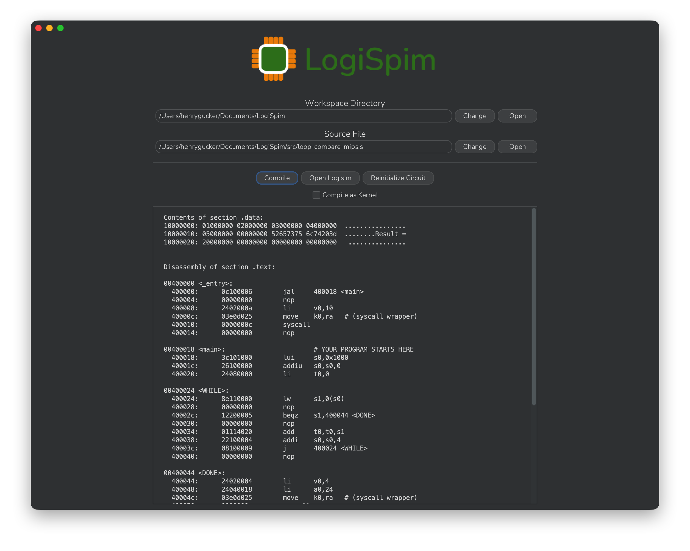

# LogiSpim Installation Guide for Windows (x86_64)

## 1. Install Logisim-evolution (v5.0.0+)
To function correctly, LogiSpim requires a Logisim-evolution version of at least v5.0.0 to be installed.

To install Logisim-evolution, download and run the most recent `...-amd64.msi` installer from the 
[releases page](https://github.com/logisim-evolution/logisim-evolution/releases).
For your convenience, [this](https://github.com/logisim-evolution/logisim-evolution/releases/download/v5.0.0/logisim-evolution-5.0.0-amd64.msi)
is a direct link to download the v5.0.0 installer.

Logisim-evolution must be installed as an application (rather than a JAR) for LogiSpim to open the processor
automatically through the `Open Logisim` button.

> [!NOTE]
> Currently, Logisim-evolution provides installers for ARM-based Windows devices (the `windows-aarch64` installer),
> but LogiSpim is not configured to produce installers for that architecture.
> Users on such devices must build the application from its source code through the Maven project
> within the repository.

## 2. Install LogiSpim

To install LogiSpim, download and run the most recent `...-windows-x86_64.exe` installer from LogiSpim's
[releases page](https://github.com/henrygucker/LogiSpim/releases).

## 3. Installation Complete
Your installation is now complete, and you should be able to launch the LogiSpim app!
When you first launch the app, it will automatically place the LogiSpim processor `.circ`
file in your LogiSpim workspace directory.

Move on to the [usage guide](../../04_usage_guide/index.md) to run your first program on the LogiSpim
processor!

