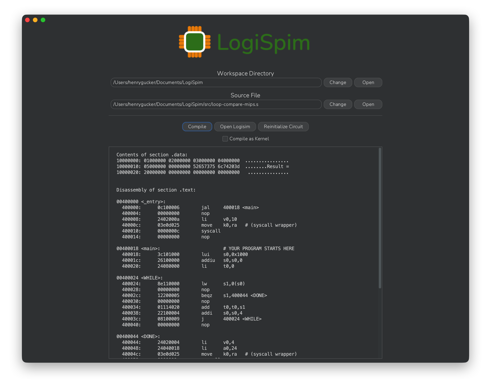

# LogiSpim Installation Guide for Linux (Debian/Ubuntu)

## 1. Install Cross-Compilation Toolchain
To compile MIPS code into binary form on Linux, a dedicated toolchain is required.

On Linux, the MIPS cross compilation toolchain provided by [this Debian package](https://packages.debian.org/sid/binutils-mipsel-linux-gnu)
is supported by the LogiSpim app.

Installation can be done as follows:
1. Update the local package index.
```shell
sudo apt update
```
2. Install the cross-compilation toolchain package.
```shell
sudo apt install binutils-mipsel-linux-gnu
```


## 2. Install Logisim-evolution (v5.0.0+)
To function correctly, LogiSpim requires a Logisim-evolution version of at least v5.0.0 to be installed.

To install Logisim-evolution, download the most recent `..._amd64.deb` package from
the [releases page](https://github.com/logisim-evolution/logisim-evolution/releases).
For your convenience, [this](https://github.com/logisim-evolution/logisim-evolution/releases/download/v5.0.0/logisim-evolution_5.0.0_amd64.deb)
is a direct link to download the v5.0.0 package.

Then, run the following command to install Logisim-evolution:
```shell
sudo apt install ./path/to/package.deb
```

> [!NOTE]
> Logisim-evolution must be installed as an application (rather than a JAR) for LogiSpim to open the processor
> automatically through the `Open Logisim` button.

## 3. Install LogiSpim

To install LogiSpim, download the most recent `...-linux-x86_64.deb` package from
LogiSpim's [releases page](https://github.com/henrygucker/LogiSpim/releases).

Then install the package by running the following command:
```shell
sudo apt install ./path/to/package.deb
```

## 4. Installation Complete
Your installation is now complete, and you should be able to launch the LogiSpim app!
When you first launch the app, it will automatically place the LogiSpim processor `.circ`
file in your LogiSpim workspace directory.

Move on to the [usage guide](../../04_usage_guide/index.md) to run your first program on the LogiSpim
processor!



