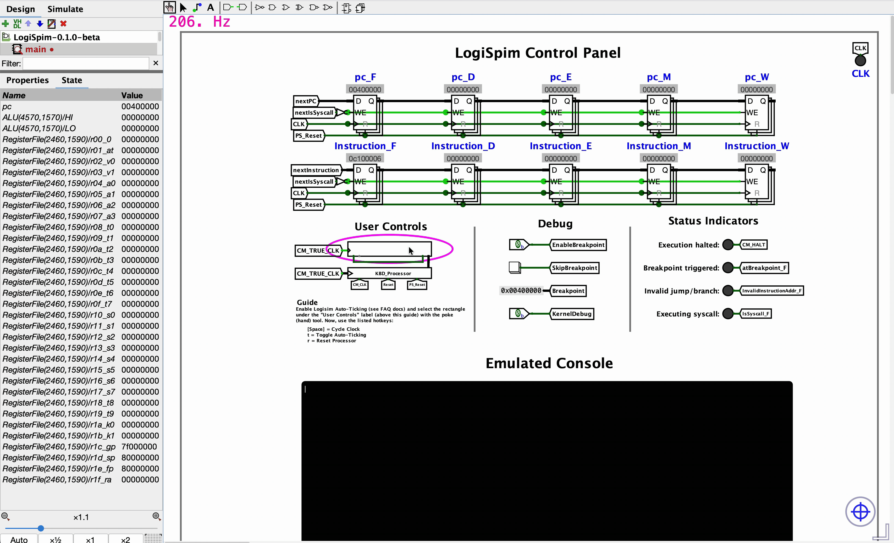

# Installation Guide

The following subsections contain guides for installing LogiSpim across varying operating systems:
 - [Installation Guide for macOS](01_macos/index.md)
 - [Installation Guide for Windows](02_windows/index.md)
 - [Installation Guide for Linux](03_linux/index.md)

