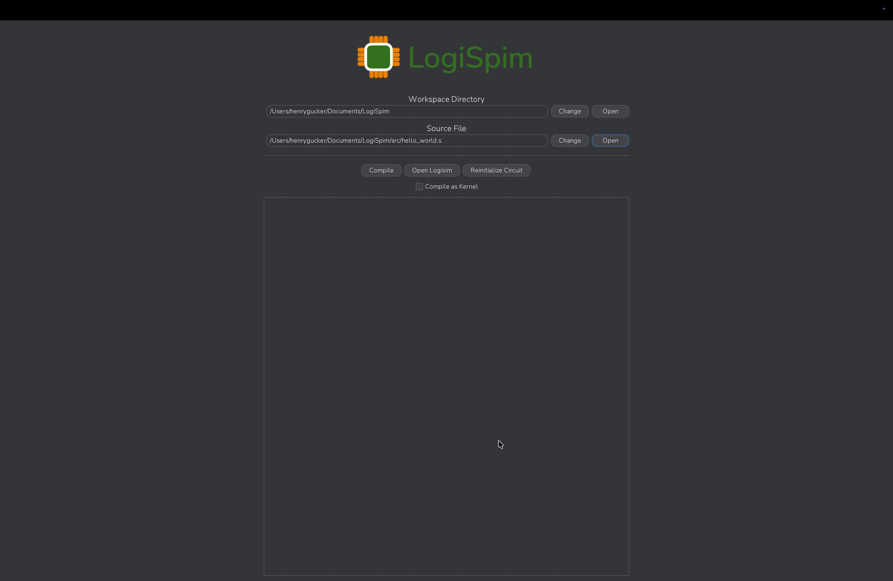
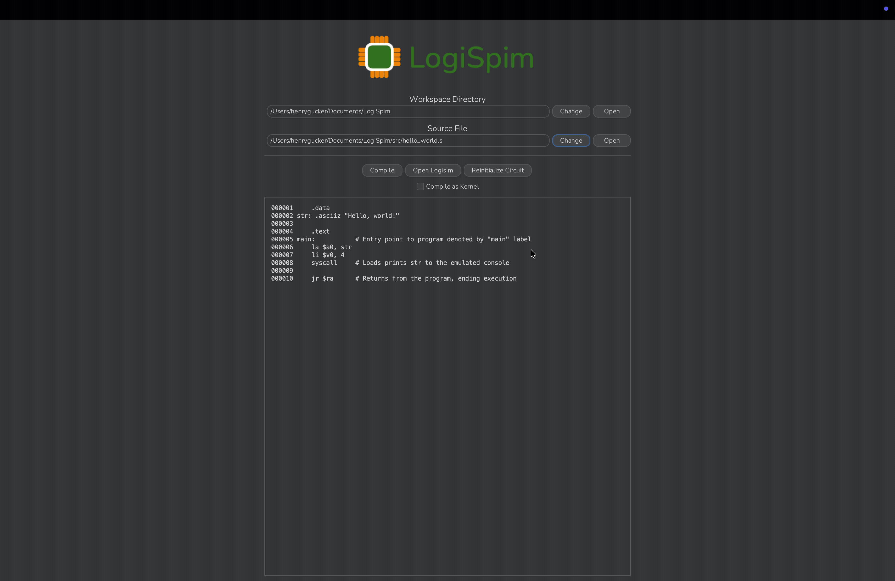
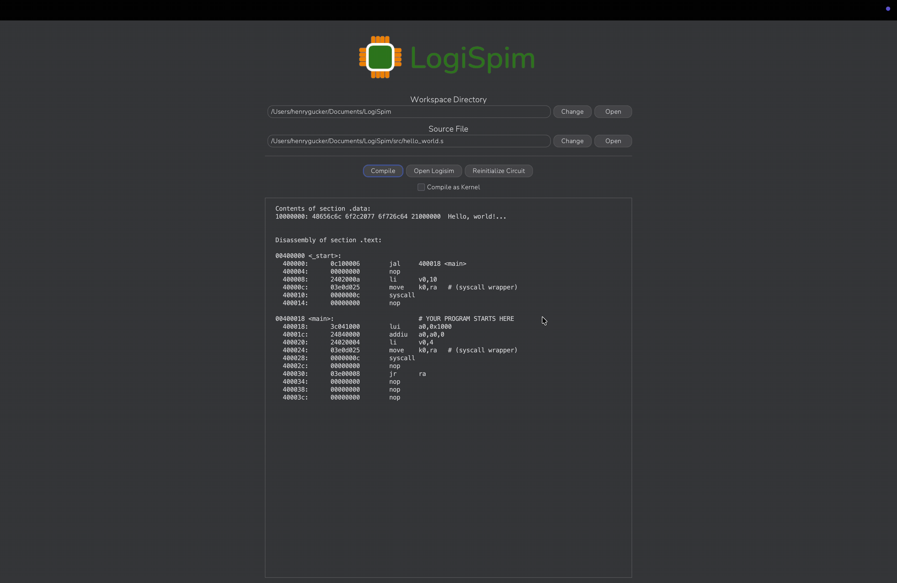
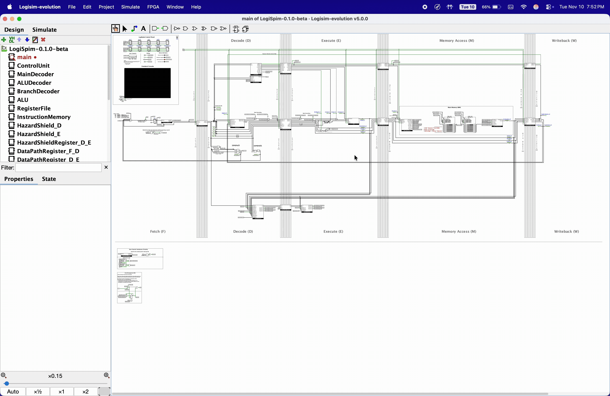
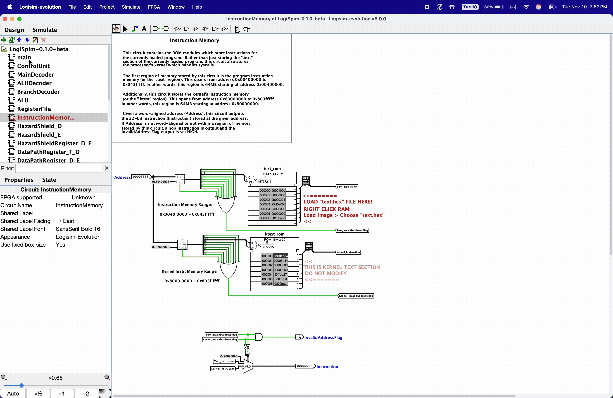
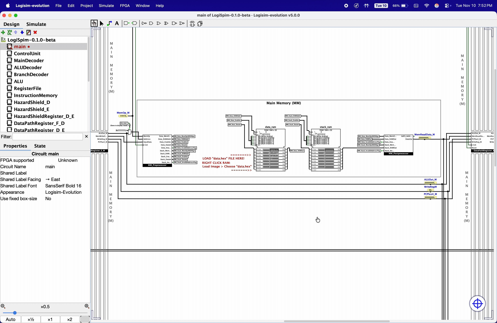

# Compiling & Loading a Program

We'll use the [example program](../01_setup/index.md#example-program) from the previous section saved to a file
named `hello_world.s`. This is provided to you by default when first launching LogiSpim.

## Compile a Program
To compile a program with LogiSpim, perform the following steps:
1. Select the source code file, in this case `src/hello_world.s`.

   

2. Press the `Compile` button to generate the files for loading into Logisim-evolution.
   Observe the program's disassembly in the text area below after successfully compiling.

   

3. Press the `Open Logisim` button to launch Logisim-evolution and move on to steps within the LogiSpim processor.

   
   
   > [!NOTE]
   > 
 
<h4 style="display: inline; margin: 0;">Not working?</h4>
  
   > If you have only installed Logisim-evolution as a JAR, the <code>Open Logisim</code> feature will not work.
   >   
   > Additionally, if Logisim-evolution (v5.0.0+) is not the program associated with <code>.circ</code> files, the feature
   > will fail as well.
   >   
   > To manually open the LogiSpim processor, press the <code>Open</code> button next to the workspace directory textbox.
   > Then, open the LogiSpim <code>.circ</code> file shown with the current LogiSpim version.
    

## Load a Program
Next, perform the following steps to load the generated `.hex` files into the processor:
1. View the `InstructionMemory` sub-circuit and load `out/hello_world/text.hex` into the ROM module named `text_rom`.

   *This loads your program's instructions into Logisim-evolution.*

   

2. Return to the `main` circuit and find the `Main Memory (MM)` area in the Memory Access (M) pipeline stage.
   Then, load `out/hello_world/data.hex` to the `data_ram` RAM module.

   *This loads your program's data into Logisim-evolution.*

   

   > [!NOTE]
   > This step may need to be repeated after program execution if modifications are made to data in this segment.

3. 

    
[Optional] Open Assembly Viewer

   To use the assembly viewer feature, navigate to `Simulate` >
   `Assembly viewer` in the menu bar. While focused on the assembly viewer window, navigate in the menu bar to `File` > `Open lss file`.
   In this menu, select `out/hello_world/diassembly-asm.lss`.

   To highlight the instruction currently within the Fetch (F) stage, select `pc_F` under the `Register` dropdown
   on the assembly viewer window. As you'll see in following steps, this window will highlight the instruction currently
   within the Fetch (F) stage.

   

