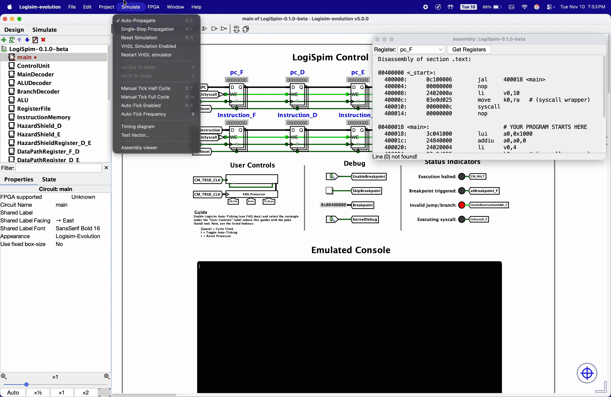
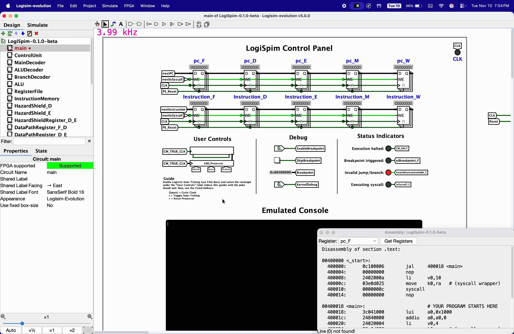
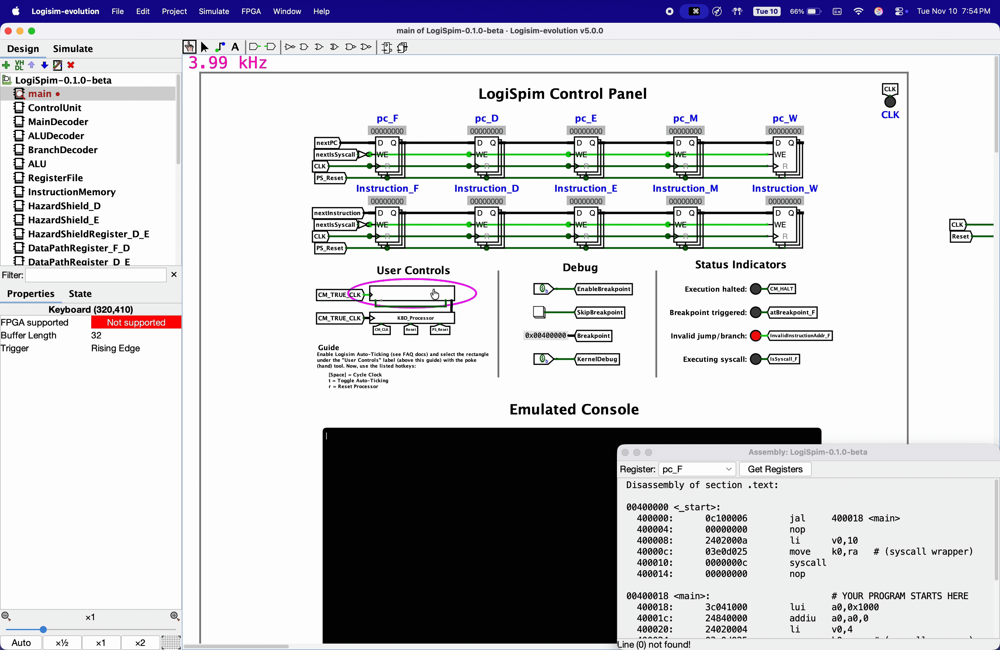
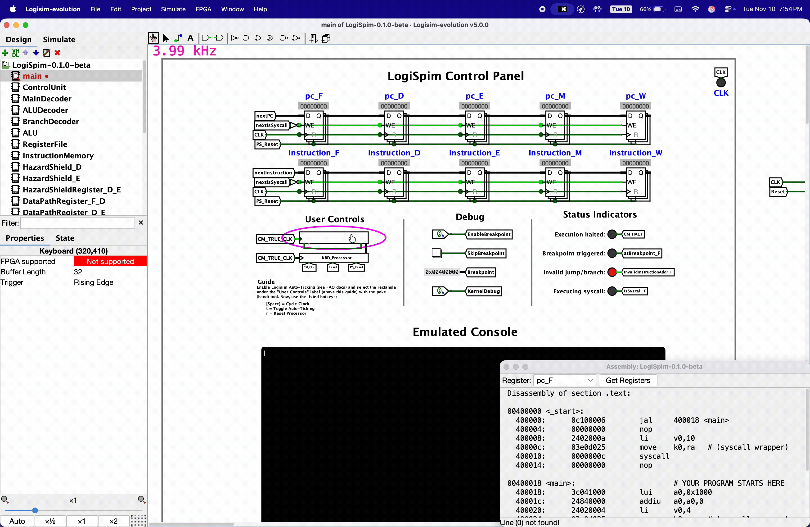
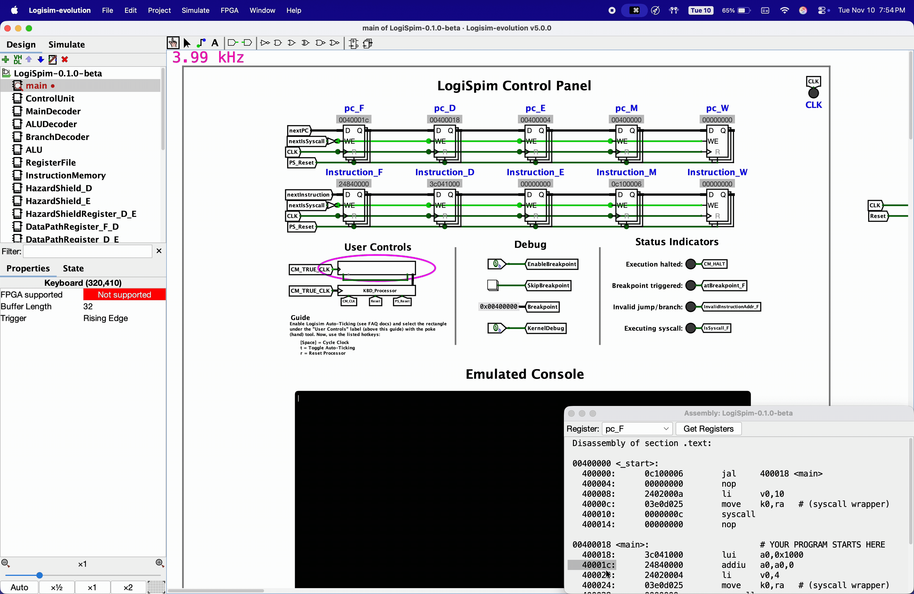

# Using the Processor

Once your program is loaded into the processor, this section guides you through running the program.

## Processor Preparation
First, a couple steps must be followed to properly set up the processor.

1. Toggle Logisim-evolution's auto-ticking on with `Ctrl + K` (or `Cmd + K` on macOS).
   You should see pink text displaying Logisim-evolution clock's frequency (ideally `>1kHz`).

   Alternatively, you can enable Auto-Tick through Logisim-evolution's menu bar.

   

2. Then, select the "Poke" tool (Hand tool) from the toolbar
   and click on the box below the `"User Controls" `label in the control panel.

   There should now be a pink oval around the box indicating that it is selected.
   While selected, this enables you to control the processor's clock with keyboard inputs.

   

3. Finally, reset the processor by pressing `r`.

   *This is the same way to reset the processor after executing a program.*

   You should see `0x00400000` load into the `pc_F` register, meaning that the first instruction of your
   program has been loaded into the Fetch (F) stage of the processor.

   

## Running the Processor
Your program has been loaded and the processor has been prepared, so now it's time to run the processor!
However, there are multiple ways to execute a program.

### Step the Clock
   Press `Space` to perform one clock cycle, stepping through your program to the next
   instruction.

   

### Auto-Tick the Clock
   Press `t` to cycle the processor's clock automatically until your program completes,
   indicated by the light next to the `"Execution halted:"` label turning red.

   After our `hello_world.s` program exits, you should see `"Hello, world!"` printed to the emulated
   console.

   *Reset the processor by pressing `r` to run your program again!*

   