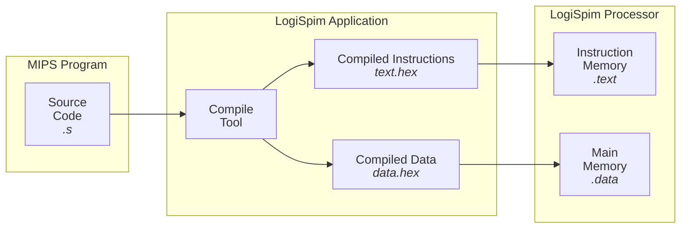

# Usage Guide

Once you've installed LogiSpim, this section walks you through running a basic MIPS program on the LogiSpim processor.

## The Workflow

In earlier sections, the following workflow was shown for running your MIPS programs on the LogiSpim processor.

This guide walks you through the workflow, step by step.

## Guide Organization
 The usage guide is split into the following three sections:

* [Setup](01_setup/index.md) - This section outlines the criteria of a MIPS program and provides a sample program which the rest of the tutorial uses.

* [Compilation & Loading](02_compilation_and_loading/index.md) - This section walks through compiling a MIPS program and loading compiled files into the processor.

* [Using the Processor](03_using_processor/index.md) - Lastly, this section shows how to use the processor once a program has been loaded.

