# Usage Guide

This section walks you through running a basic MIPS program on the LogiSpim processor, 
assuming all installation steps from the previous section were completed.

## The Workflow
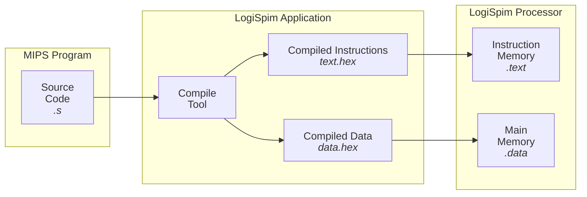

Above is the process for compiling and running MIPS programs on the LogiSpim processor that this guide will walk you through.
The steps necessary for a block on the flowchart are given in its respective section below.

## MIPS Program
For MIPS assembly source code to be considered a LogiSpim program, it must satisfy a few conditions:
1. It must have a `main` label in the `.text` segment.
   * This is handled the same way as in [QtSpim](https://spimsimulator.sourceforge.net).
   * The `main` label serves as the entry point for a LogiSpim program.
   * To end the program's execution, the main program must return to the address stored in `$ra` following the initial jump to `main`.
2. It must only use `.text` and `.data` segments.
   * LogiSpim does not yet support more specialized segments such as `.rodata` or `.bss`.
3. It must only use instructions implemented by LogiSpim (see [FAQ](../06_processor_overview/index.md)).
   * While it does implement most instructions, LogiSpim does not yet support **all** MIPS instructions or syscall codes.

### Example
A simple example for a LogiSpim program is the following "Hello, world!" program.
```asm
{{#include assets/hello_world.s }}
```

## LogiSpim Application

We'll use the [example program](#example) from above saved to a file named `hello_world.s`. This is provided to you
by default when first launching LogiSpim.

To do so, perform the following steps:
1. First, launch the LogiSpim app.

2. Select the source code file, in this case `src/hello_world.s`, by pressing the `Change` button.

   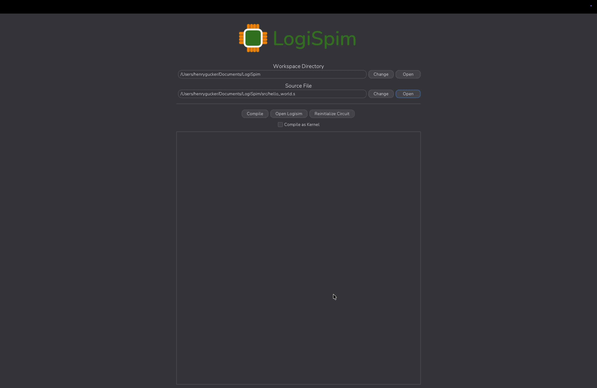

3. Press the `Compile` button to generate the files for loading into Logisim-evolution.
   Observe the program's disassembly in the text area below after successfully compiling.

   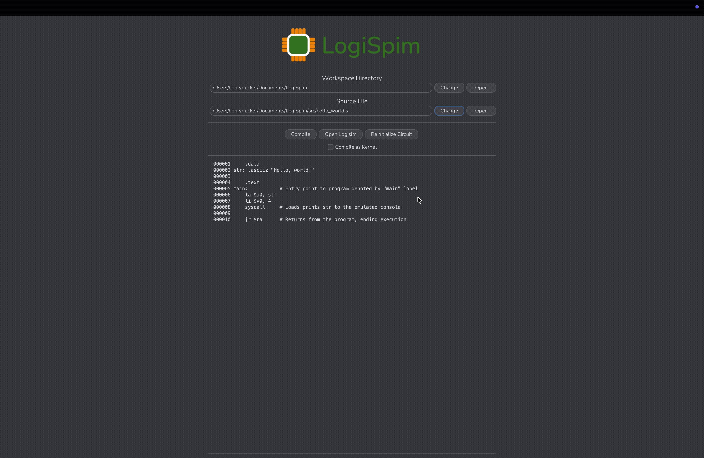

4. Press the `Open Logisim` button to launch Logisim-evolution and move on to steps within the LogiSpim processor.

   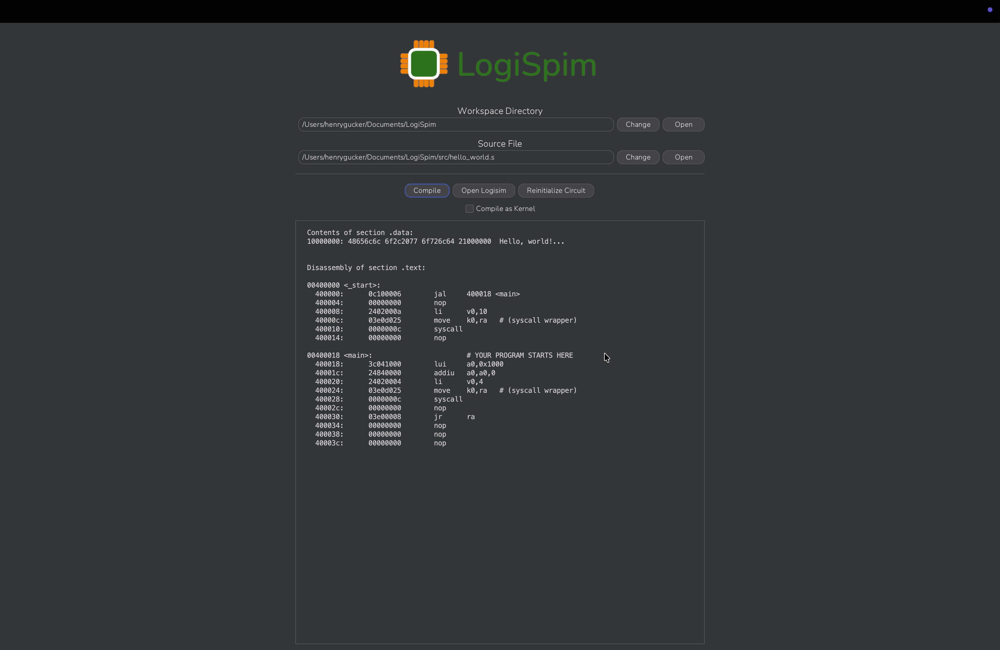
   > [!NOTE]
   > If you have only installed Logisim-evolution as a JAR, the `Open Logisim` feature will not work.
   > Additionally, if Logisim-evolution (v5.0.0+) is not the program associated with `.circ` files, the feature
   > will fail as well.
   > <br/><br/>
   > To manually open the LogiSpim processor, press the `Open` button next to the workspace directory textbox.
   > Then, open the LogiSpim `.circ` file shown.


## LogiSpim Processor
Once the LogiSpim processor is open, perform the following steps to load the generated `.hex` files and run
your program:
1. View the `InstructionMemory` sub-circuit and follow the instructions in large red text to load the `out` >
   `hello_world` > `text.hex` file into the ROM module storing user instructions (named `text_rom`).

   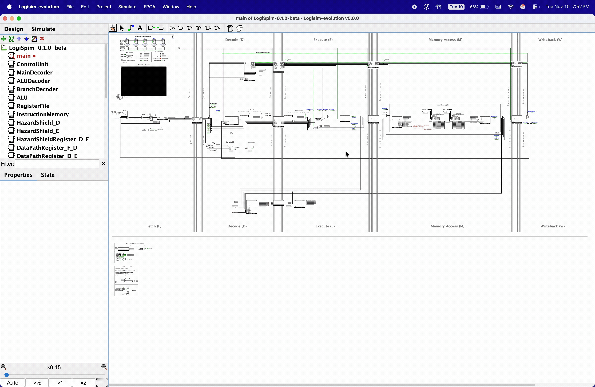

2. Return to the `main` circuit and find the `Main Memory (MM)` area in the Memory Access (M) pipeline stage.
   Follow the instructions in the large red text next to the `data_ram` RAM module to load the `out` > 
   `hello_world` > `data.hex` file. 

   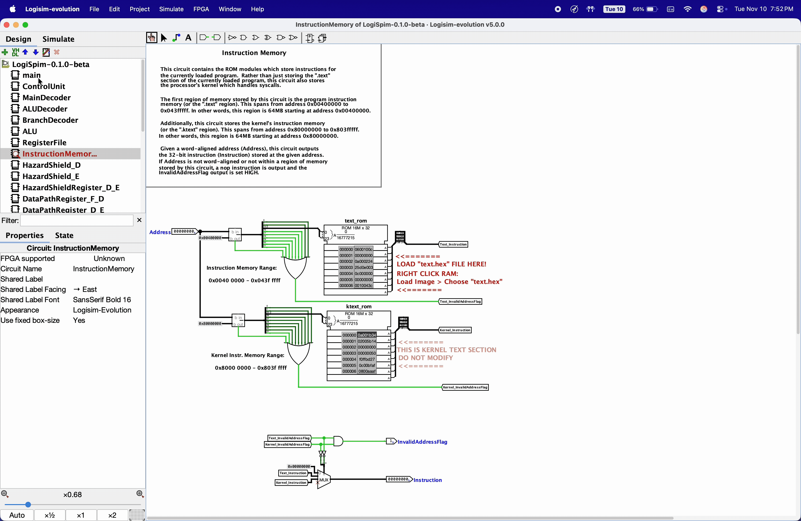

   > [!NOTE]
   > This step may need to be repeated after program execution if modifications are made to data in this segment.


3. <details style="display: inline">
    <summary>Open Assembly Viewer (Optional)</summary>

   To use the assembly viewer feature, navigate in the menu bar to `Simulate` >
   `Assembly viewer`. While focused on the assembly viewer window, navigate in the menu bar to `File` > `Open lss file`.
   To highlight the instruction currently within the Fetch (F) stage, select `pc_F` under the `Register` dropdown
   on the assembly viewer window. As you'll see in following steps, this window will highlight the instruction currently
   within the Fetch (F) stage.

   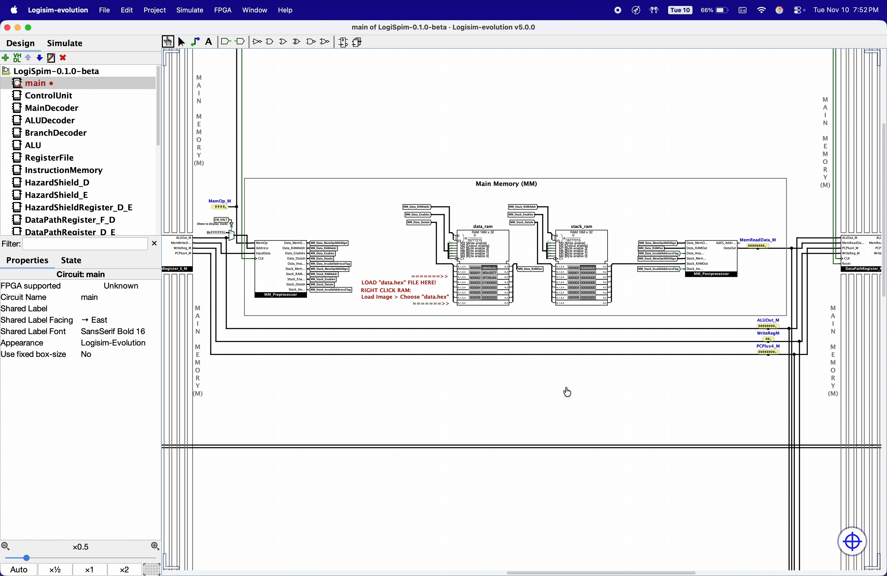

</details>

4. Now that the program is loaded, it's time to run the processor!
   To do so, return to the upper-left corner of the main circuit and view the user control panel. Then, set the auto-tick
   clock frequency of Logisim to your desired frequency (`>1kHz`) through the `Simulate` > `Auto-Tick Frequency` dropdown menu.

   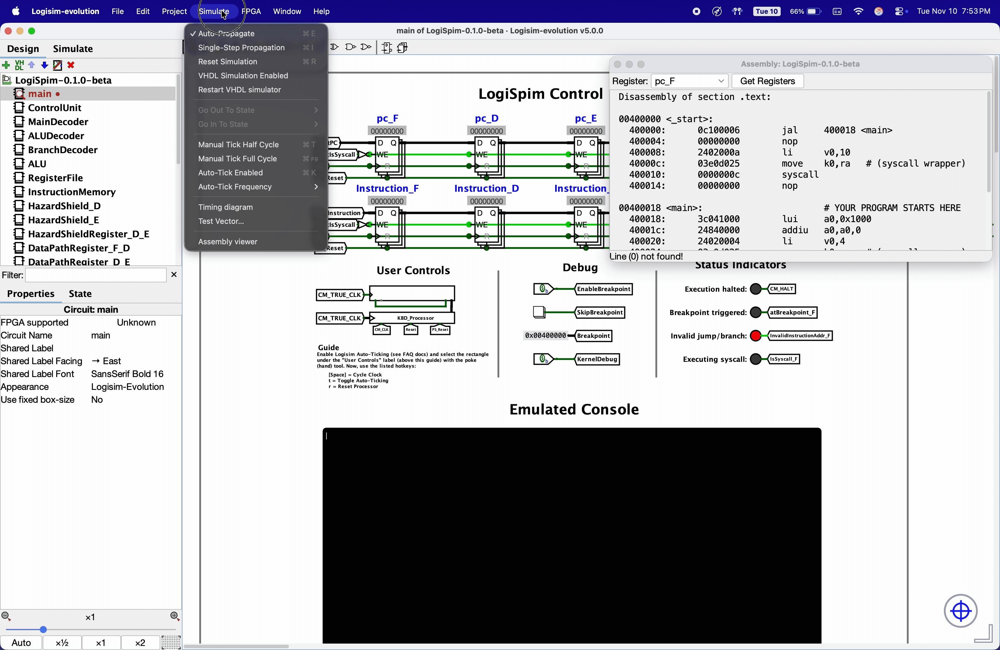

5. Then, toggle Logisim-evolution's auto-ticking on by selecting `Simulate` > `Auto-Tick Enabled` in the menu bar.
   You should see pink text displaying the Logisim-evolution clock's frequency.

   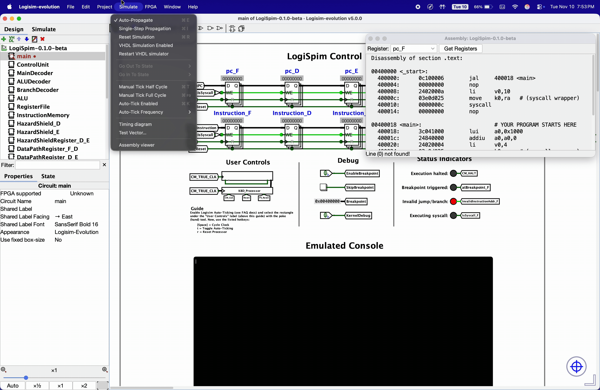

6. After auto-ticking is enabled within Logisim-evolution, select the "Poke" tool (Hand tool) from the tool bar
   and click on the box below the `"User Controls" `label in the control panel.
   There should now be a pink oval around the box indicating that it is selected.
   While selected, this enables you to control the processor's clock with keyboard inputs.

   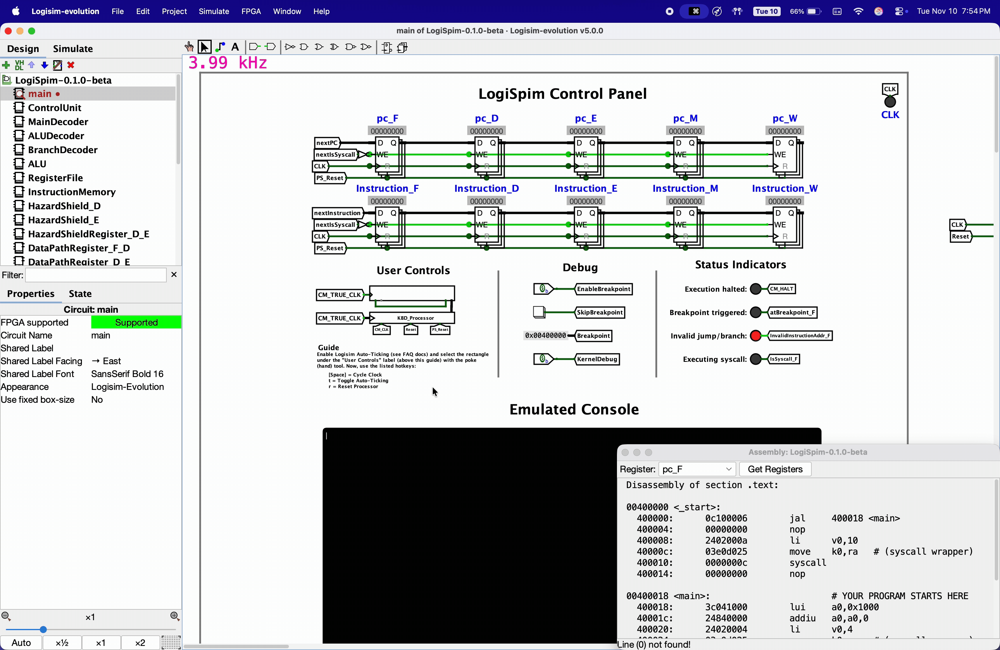

7. The final step to prepare the processor is resetting the processor by pressing `r` on your keyboard.
   You should see `0x00400000` load into the `pc_F` register, meaning that the first instruction of your
   program has been loaded into the Fetch (F) stage of the processor.

   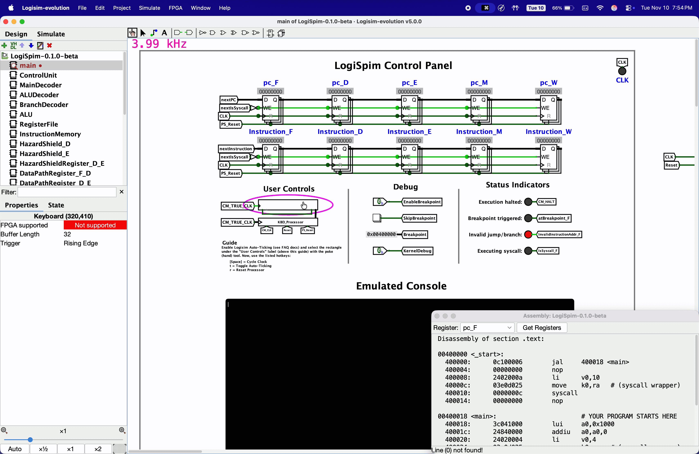

8. Press `Space` on your keyboard to perform one clock cycle, stepping through your program to the next
   instruction.

   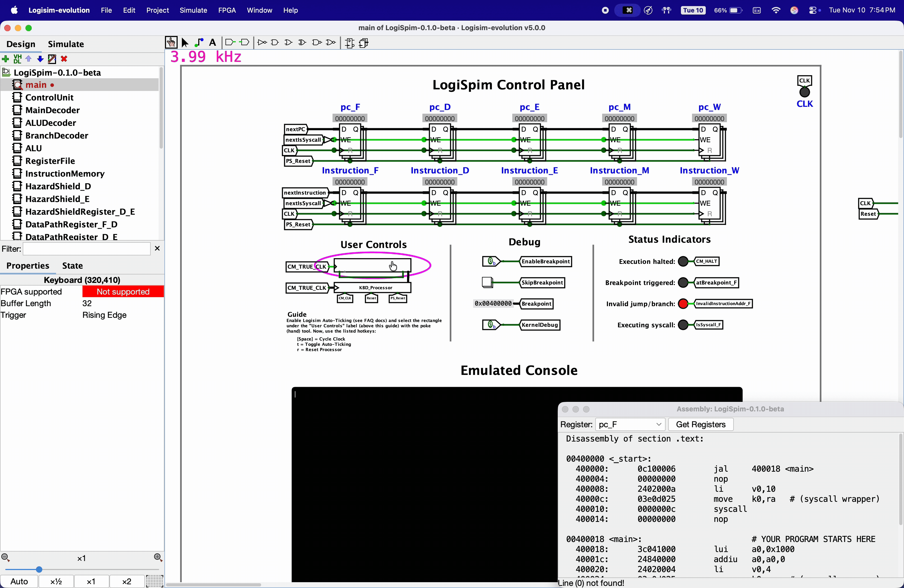

9. Press `t` on your keyboard to cycle the processor's clock automatically until your program completes,
   indicated by the light next to the `"Execution halted:"` label turning red.
   After our `hello_world.s` program exits, you should see `"Hello, world!"` printed to the emulated
   console.

   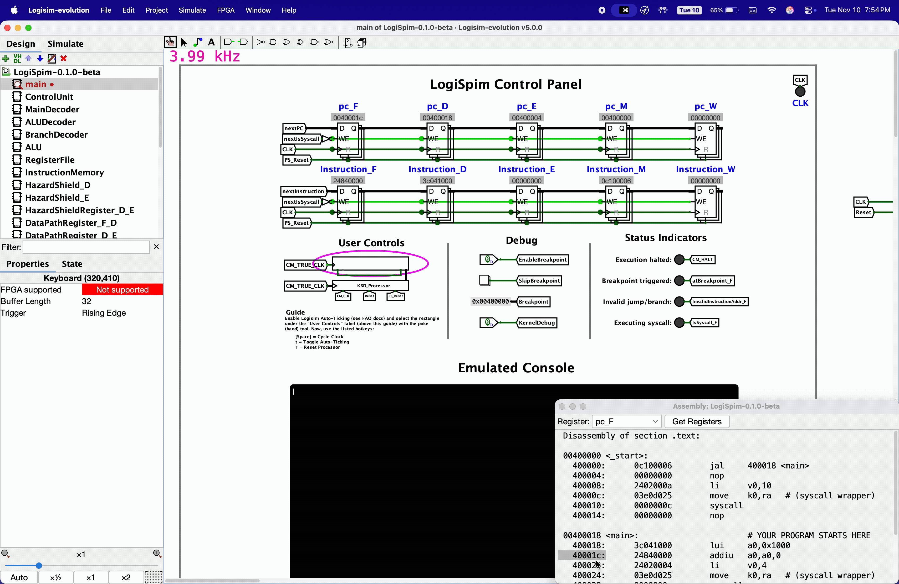

10. To reset the processor to run the program again, simply press `r`. As long as your program did not modify any
   values in the `.data` section, this is all it takes to reset the processor. You can then use any of the keybinds
   to cycle the clock once again. Feel free to stop at a specific instruction and follow it through the pipeline
   to see how it works! <br/><br/>
   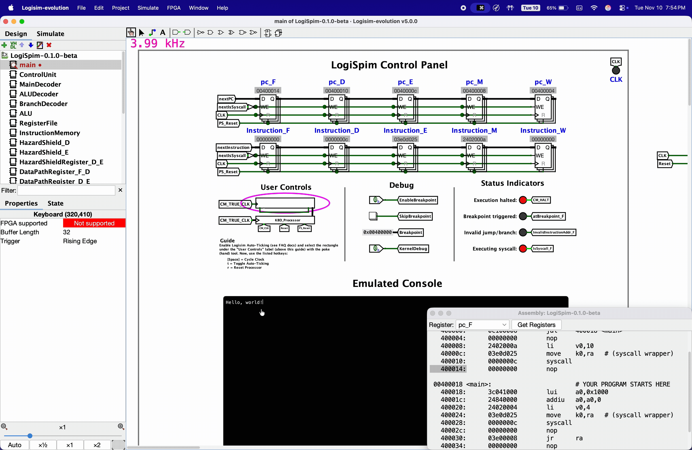


## Additional Information
It is also possible to view the state of all registers at any given point by de-selecting any components, and
selecting the `State` tab on the left side of the Logisim-evolution window.

If any issues occur, refer to the [FAQ](../05_faq/index.md) page. If your issue is not addressed by any information in
the FAQ, create an issue on the GitHub repository detailing your problem
and how to replicate it (include screenshots).
