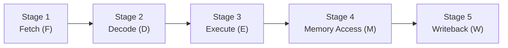
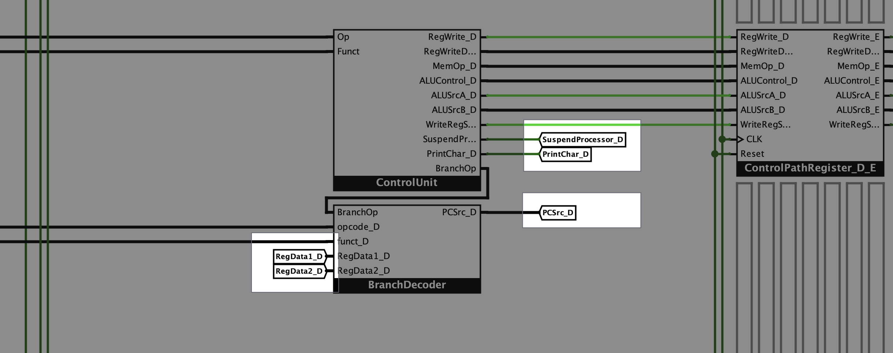
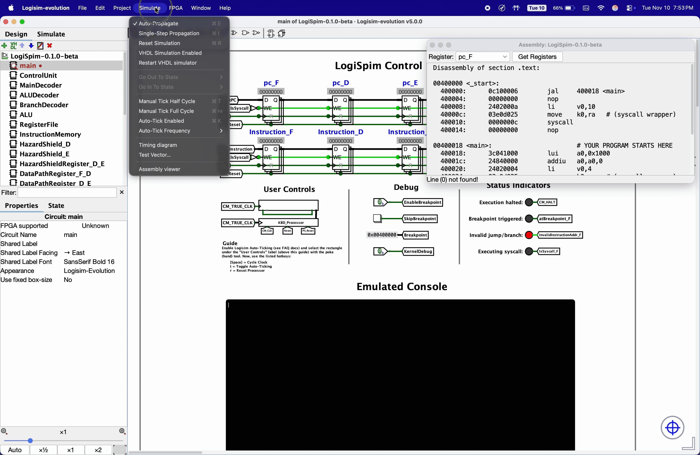
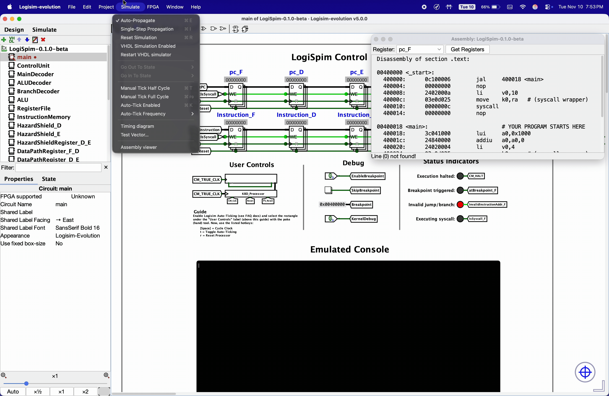
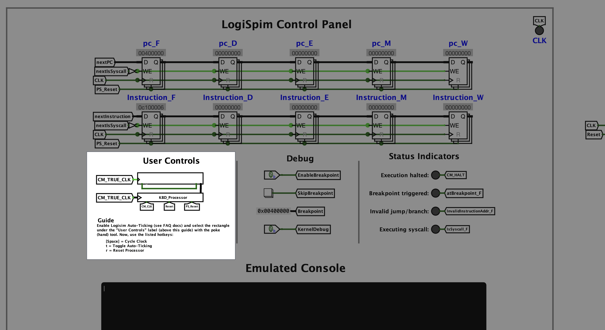
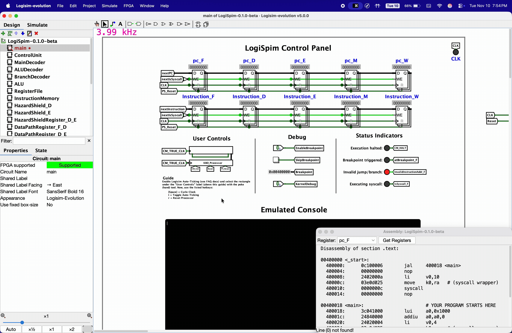

# LogiSpim Processor FAQ
Click on any question below to view an answer.

  

    <h3 style="display: inline; margin: 0">Q: What is pipelining? </h3>
  

<h3>Pipelining Overview</h3>
The processor's pipeline follows the standard 5-stage RISC pipeline, depicted below:

The primary goal of each respective pipeline stage is as follows:
1. Instruction is fetched from memory
2. The instruction is decoded and contents of relevant general-purpose registers are read
3. Arithmetic operations are executed by the ALU
4. Main Memory is either read from or written to
5. Resulting value is written into its destination register

When put together, these steps can perform any MIPS instruction.

<h4>Pipelining Challenges</h4>
Without immediate branching/jumps or register writeback, pipelining can cause hazards.
Such hazards are often difficult to predict, but LogiSpim eases that difficulty by visually displaying hazards as they occur.

Additionally, the processor has a Hazard Shield to handle most data hazards through data forwarding; however, this does
not prevent **all** possible hazards.
___

 

  

    <h3 style="display: inline; margin: 0">Q: What do the "Tunnel" components do in Logisim? </h3>
    

    
    

  

Tunnels are used all across the LogiSpim processor circuit to decrease clutter.
They allow for transmission of signals without direct wires between them, visually simplifying complicated circuits.

**Any two tunnels that share the same name are connected.**
However, the LogiSpim processor's pipelined architecture causes multiple signals to have the same name.
To avoid this, LogiSpim has an established naming convention for tunnels:

* In the LogiSpim main circuit, all main signals have a suffix corresponding to the pipeline stage they originate from.
  * Example: As is seen in the picture above, the signal carrying the `PCSrc` control path signal in the Decode (D)
  stage of the pipeline is referred to as `PCSrc_D`.

* Tunnels carrying signals internal to specific components that exist directly in the main circuit—such as Main Memory
or the Clock Divider—are named with a prefix corresponding to the component they originate from.
  * Example: `CM_HALT` from within the Clock Management (CM) component
___

 

  

    <h3 style="display: inline; margin: 0">Q: What instructions does the processor support? </h3>
  

<!--suppress CssUnresolvedCustomProperty -->

The instruction set implemented in this processor was based on [this MIPS reference sheet](https://booksite.elsevier.com/9780124077263/downloads/COD_5e_Greencard.pdf).

<table>
    <thead>
        <tr> <th>OP/Funct</th> <th>I-Type & J-Type Instructions</th> <th>R-Type Instructions</th> </tr>
    </thead>
<tbody><tr>
    <td style="padding: 0 0; border: 0 white solid">
        <table>
            <thead>
                <tr> <th>#</th> <th>Binary</th> </tr>
            </thead>
            <tbody>
                <tr> <td>0</td>  <td style="white-space: nowrap">0000 00</td></tr>
                <tr> <td>1</td>  <td>0000 01</td></tr>
                <tr> <td>2</td>  <td>0000 10</td></tr>
                <tr> <td>3</td>  <td>0000 11</td></tr>
                <tr> <td>4</td>  <td>0001 00</td></tr>
                <tr> <td>5</td>  <td>0001 01</td></tr>
                <tr> <td>6</td>  <td>0001 10</td></tr>
                <tr> <td>7</td>  <td>0001 11</td></tr>
                <tr> <td>8</td>  <td>0010 00</td></tr>
                <tr> <td>9</td>  <td>0010 01</td></tr>
                <tr> <td>10</td> <td>0010 10</td></tr>
                <tr> <td>11</td> <td>0010 11</td></tr>
                <tr> <td>12</td> <td>0011 00</td></tr>
                <tr> <td>13</td> <td>0011 01</td></tr>
                <tr> <td>14</td> <td>0011 10</td></tr>
                <tr> <td>15</td> <td>0011 11</td></tr>
                <tr> <td>16</td> <td>0100 00</td></tr>
                <tr> <td>17</td> <td>0100 01</td></tr>
                <tr> <td>18</td> <td>0100 10</td></tr>
                <tr> <td>19</td> <td>0100 11</td></tr>
                <tr> <td>20</td> <td>0101 00</td></tr>
                <tr> <td>21</td> <td>0101 01</td></tr>
                <tr> <td>22</td> <td>0101 10</td></tr>
                <tr> <td>23</td> <td>0101 11</td></tr>
                <tr> <td>24</td> <td>0110 00</td></tr>
                <tr> <td>25</td> <td>0110 01</td></tr>
                <tr> <td>26</td> <td>0110 10</td></tr>
                <tr> <td>27</td> <td>0110 11</td></tr>
                <tr> <td>28</td> <td>0111 00</td></tr>
                <tr> <td>29</td> <td>0111 01</td></tr>
                <tr> <td>30</td> <td>0111 10</td></tr>
                <tr> <td>31</td> <td>0111 11</td></tr>
                <tr> <td>32</td> <td>1000 00</td></tr>
                <tr> <td>33</td> <td>1000 01</td></tr>
                <tr> <td>34</td> <td>1000 10</td></tr>
                <tr> <td>35</td> <td>1000 11</td></tr>
                <tr> <td>36</td> <td>1001 00</td></tr>
                <tr> <td>37</td> <td>1001 01</td></tr>
                <tr> <td>38</td> <td>1001 10</td></tr>
                <tr> <td>39</td> <td>1001 11</td></tr>
                <tr> <td>40</td> <td>1010 00</td></tr>
                <tr> <td>41</td> <td>1010 01</td></tr>
                <tr> <td>42</td> <td>1010 10</td></tr>
                <tr> <td>43</td> <td>1010 11</td></tr>
                <tr> <td>44</td> <td>1011 00</td></tr>
                <tr> <td>45</td> <td>1011 01</td></tr>
                <tr> <td>46</td> <td>1011 10</td></tr>
                <tr> <td>47</td> <td>1011 11</td></tr>
                <tr> <td>48</td> <td>1100 00</td></tr>
                <tr> <td>49</td> <td>1100 01</td></tr>
                <tr> <td>50</td> <td>1100 10</td></tr>
                <tr> <td>51</td> <td>1100 11</td></tr>
                <tr> <td>52</td> <td>1101 00</td></tr>
                <tr> <td>53</td> <td>1101 01</td></tr>
                <tr> <td>54</td> <td>1101 10</td></tr>
                <tr> <td>55</td> <td>1101 11</td></tr>
                <tr> <td>56</td> <td>1110 00</td></tr>
                <tr> <td>57</td> <td>1110 01</td></tr>
                <tr> <td>58</td> <td>1110 10</td></tr>
                <tr> <td>59</td> <td>1110 11</td></tr>
                <tr> <td>60</td> <td>1111 00</td></tr>
                <tr> <td>61</td> <td>1111 01</td></tr>
                <tr> <td>62</td> <td>1111 10</td></tr>
                <tr> <td>63</td> <td>1111 11</td></tr>
            </tbody>
        </table>
    </td>
    <td style="padding: 0 0; border: 0 white solid">
        <table>
            <thead>
                <tr> <th>Name</th> <th></th> <th>Note</th> </tr>
            </thead>
            <tbody>
                <tr> <td style="white-space: nowrap">R-Type</td> <td class="in-progress"></td> <td>See Table</td> </tr>
                <tr> <td></td> <td>&ZeroWidthSpace;</td> <td></td> </tr>
                <tr> <td><code>j</code></td> <td class="implemented"></td> <td>Implemented</td> </tr>
                <tr> <td><code>jal</code></td> <td class="implemented"></td> <td>Implemented</td> </tr>
                <tr> <td><code>beq</code></td> <td class="implemented"></td> <td>Implemented</td> </tr>
                <tr> <td><code>bne</code></td> <td class="implemented"></td> <td>Implemented</td> </tr>
                <tr> <td><code>blez</code></td> <td class="implemented"></td> <td>Implemented</td> </tr>
                <tr> <td><code>bgtz</code></td> <td class="implemented"></td> <td>Implemented</td> </tr>
                <tr> <td><code>addi</code></td> <td class="implemented"></td> <td>Implemented</td> </tr>
                <tr> <td><code>addiu</code></td> <td class="implemented"></td> <td>Implemented</td> </tr>
                <tr> <td><code>slti</code></td> <td class="implemented"></td> <td>Implemented</td> </tr>
                <tr> <td><code>sltiu</code></td> <td class="implemented"></td> <td>Implemented</td> </tr>
                <tr> <td><code>andi</code></td> <td class="implemented"></td> <td>Implemented</td> </tr>
                <tr> <td><code>ori</code></td> <td class="implemented"></td> <td>Implemented</td> </tr>
                <tr> <td><code>xori</code></td> <td class="implemented"></td> <td>Implemented</td> </tr>
                <tr> <td><code>lui</code></td> <td class="implemented"></td> <td>Implemented</td> </tr>
                <tr> <td></td> <td>&ZeroWidthSpace;</td> <td></td> </tr>
                <tr> <td>F-Type</td> <td class="not-implemented"></td> <td style="white-space: nowrap">Not Yet Implemented</td> </tr>
                <tr> <td></td> <td>&ZeroWidthSpace;</td> <td></td> </tr>
                <tr> <td></td> <td>&ZeroWidthSpace;</td> <td></td> </tr>
                <tr> <td></td> <td>&ZeroWidthSpace;</td> <td></td> </tr>
                <tr> <td></td> <td>&ZeroWidthSpace;</td> <td></td> </tr>
                <tr> <td></td> <td>&ZeroWidthSpace;</td> <td></td> </tr>
                <tr> <td></td> <td>&ZeroWidthSpace;</td> <td></td> </tr>
                <tr> <td></td> <td>&ZeroWidthSpace;</td> <td></td> </tr>
                <tr> <td></td> <td>&ZeroWidthSpace;</td> <td></td> </tr>
                <tr> <td></td> <td>&ZeroWidthSpace;</td> <td></td> </tr>
                <tr> <td></td> <td>&ZeroWidthSpace;</td> <td></td> </tr>
                <tr> <td></td> <td>&ZeroWidthSpace;</td> <td></td> </tr>
                <tr> <td></td> <td>&ZeroWidthSpace;</td> <td></td> </tr>
                <tr> <td></td> <td>&ZeroWidthSpace;</td> <td></td> </tr>
                <tr> <td></td> <td>&ZeroWidthSpace;</td> <td></td> </tr>
                <tr> <td><code>lb</code></td> <td class="implemented"></td> <td>Implemented</td> </tr>
                <tr> <td><code>lh</code></td> <td class="implemented"></td> <td>Implemented</td> </tr>
                <tr> <td><code>lwl</code></td> <td class="implemented"></td> <td>Implemented</td> </tr>
                <tr> <td><code>lw</code></td> <td class="implemented"></td> <td>Implemented</td> </tr>
                <tr> <td><code>lbu</code></td> <td class="implemented"></td> <td>Implemented</td> </tr>
                <tr> <td><code>lhu</code></td> <td class="implemented"></td> <td>Implemented</td> </tr>
                <tr> <td><code>lwr</code></td> <td class="implemented"></td> <td>Implemented</td> </tr>
                <tr> <td></td> <td>&ZeroWidthSpace;</td> <td></td> </tr>
                <tr> <td><code>sb</code></td> <td class="implemented"></td> <td>Implemented</td> </tr>
                <tr> <td><code>sh</code></td> <td class="implemented"></td> <td>Implemented</td> </tr>
                <tr> <td><code>swl</code></td> <td class="implemented"></td> <td>Implemented</td> </tr>
                <tr> <td><code>sw</code></td> <td class="implemented"></td> <td>Implemented</td> </tr>
                <tr> <td></td> <td>&ZeroWidthSpace;</td> <td></td> </tr>
                <tr> <td></td> <td>&ZeroWidthSpace;</td> <td></td> </tr>
                <tr> <td><code>swr</code></td> <td class="implemented"></td> <td>Implemented</td> </tr>
                <tr> <td><code>cache</code></td> <td class="not-implemented"></td> <td>Not Yet Implemented</td> </tr>
                <tr> <td><code>ll</code></td> <td class="not-implemented"></td> <td>Not Yet Implemented</td> </tr>
                <tr> <td><code>lwc1</code></td> <td class="not-implemented"></td> <td>Not Yet Implemented</td> </tr>
                <tr> <td><code>lwc2</code></td> <td class="not-implemented"></td> <td>Not Yet Implemented</td> </tr>
                <tr> <td><code>pref</code></td> <td class="not-implemented"></td> <td>Not Yet Implemented</td> </tr>
                <tr> <td></td> <td>&ZeroWidthSpace;</td> <td></td> </tr>
                <tr> <td><code>ldc1</code></td> <td class="not-implemented"></td> <td>Not Yet Implemented</td> </tr>
                <tr> <td><code>ldc2</code></td> <td class="not-implemented"></td> <td>Not Yet Implemented</td> </tr>
                <tr> <td></td> <td>&ZeroWidthSpace;</td> <td></td> </tr>
                <tr> <td><code>sc</code></td> <td class="not-implemented"></td> <td>Not Yet Implemented</td> </tr>
                <tr> <td><code>swc1</code></td> <td class="not-implemented"></td> <td>Not Yet Implemented</td> </tr>
                <tr> <td><code>swc2</code></td> <td class="not-implemented"></td> <td>Not Yet Implemented</td> </tr>
                <tr> <td></td> <td>&ZeroWidthSpace;</td> <td></td> </tr>
                <tr> <td></td> <td>&ZeroWidthSpace;</td> <td></td> </tr>
                <tr> <td><code>sdc1</code></td> <td class="not-implemented"></td> <td>Not Yet Implemented</td> </tr>
                <tr> <td><code>sdc2</code></td> <td class="not-implemented"></td> <td>Not Yet Implemented</td> </tr>
                <tr> <td></td> <td>&ZeroWidthSpace;</td> <td></td> </tr>
            </tbody>
        </table>
    </td>
    <td style="padding: 0 0; border: 0 white solid">
        <table>
            <thead>
                <tr> <th>Name</th> <th></th> <th>Note</th> </tr>
            </thead>
            <tbody>
                <tr> <td><code>sll</code></td> <td class="implemented"></td> <td>Implemented</td> </tr>
                <tr> <td></td> <td>&ZeroWidthSpace;</td> <td></td> </tr>
                <tr> <td><code>srl</code></td> <td class="implemented"></td> <td>Implemented</td> </tr>
                <tr> <td><code>sra</code></td> <td class="implemented"></td> <td>Implemented</td> </tr>
                <tr> <td><code>sllv</code></td> <td class="implemented"></td> <td>Implemented</td> </tr>
                <tr> <td></td> <td>&ZeroWidthSpace;</td> <td></td> </tr>
                <tr> <td><code>srlv</code></td> <td class="implemented"></td> <td>Implemented</td> </tr>
                <tr> <td><code>srav</code></td> <td class="implemented"></td> <td>Implemented</td> </tr>
                <tr> <td><code>jr</code></td> <td class="implemented"></td> <td>Implemented</td> </tr>
                <tr> <td><code>jalr</code></td> <td class="implemented"></td> <td>Implemented</td> </tr>
                <tr> <td><code>movz</code></td> <td class="not-implemented"></td> <td>Not Yet Implemented</td> </tr>
                <tr> <td><code>movn</code></td> <td class="not-implemented"></td> <td>Not Yet Implemented</td> </tr>
                <tr> <td><code>syscall</code></td> <td class="implemented"></td> <td>Implemented<a href="#footnote1">*</a></td> </tr>
                <tr> <td><code>break</code></td> <td class="not-implemented"></td> <td style="white-space: nowrap">Not Yet Implemented</td> </tr>
                <tr> <td></td> <td>&ZeroWidthSpace;</td> <td></td> </tr>
                <tr> <td><code>sync</code></td> <td class="not-implemented"></td> <td>Not Yet Implemented</td> </tr>
                <tr> <td><code>mfhi</code></td> <td class="implemented"></td> <td>Implemented</td> </tr>
                <tr> <td><code>mthi</code></td> <td class="implemented"></td> <td>Implemented</td> </tr>
                <tr> <td><code>mflo</code></td> <td class="implemented"></td> <td>Implemented</td> </tr>
                <tr> <td><code>mtlo</code></td> <td class="implemented"></td> <td>Implemented</td> </tr>
                <tr> <td></td> <td>&ZeroWidthSpace;</td> <td></td> </tr>
                <tr> <td></td> <td>&ZeroWidthSpace;</td> <td></td> </tr>
                <tr> <td></td> <td>&ZeroWidthSpace;</td> <td></td> </tr>
                <tr> <td></td> <td>&ZeroWidthSpace;</td> <td></td> </tr>
                <tr> <td><code>mult</code></td> <td class="implemented"></td> <td>Implemented</td> </tr>
                <tr> <td><code>multu</code></td> <td class="implemented"></td> <td>Implemented</td> </tr>
                <tr> <td><code>div</code></td> <td class="implemented"></td> <td>Implemented</td> </tr>
                <tr> <td><code>divu</code></td> <td class="implemented"></td> <td>Implemented</td> </tr>
                <tr> <td></td> <td>&ZeroWidthSpace;</td> <td></td> </tr>
                <tr> <td></td> <td>&ZeroWidthSpace;</td> <td></td> </tr>
                <tr> <td></td> <td>&ZeroWidthSpace;</td> <td></td> </tr>
                <tr> <td></td> <td>&ZeroWidthSpace;</td> <td></td> </tr>
                <tr> <td><code>add</code></td> <td class="implemented"></td> <td>Implemented</td> </tr>
                <tr> <td><code>addu</code></td> <td class="implemented"></td> <td>Implemented</td> </tr>
                <tr> <td><code>sub</code></td> <td class="implemented"></td> <td>Implemented</td> </tr>
                <tr> <td><code>subu</code></td> <td class="implemented"></td> <td>Implemented</td> </tr>
                <tr> <td><code>and</code></td> <td class="implemented"></td> <td>Implemented</td> </tr>
                <tr> <td><code>or</code></td> <td class="implemented"></td> <td>Implemented</td> </tr>
                <tr> <td><code>xor</code></td> <td class="implemented"></td> <td>Implemented</td> </tr>
                <tr> <td><code>nor</code></td> <td class="implemented"></td> <td>Implemented</td> </tr>
                <tr> <td></td> <td>&ZeroWidthSpace;</td> <td></td> </tr>
                <tr> <td></td> <td>&ZeroWidthSpace;</td> <td></td> </tr>
                <tr> <td><code>slt</code></td> <td class="implemented"></td> <td>Implemented</td> </tr>
                <tr> <td><code>sltu</code></td> <td class="implemented"></td> <td>Implemented</td> </tr>
                <tr> <td></td> <td>&ZeroWidthSpace;</td> <td></td> </tr>
                <tr> <td></td> <td>&ZeroWidthSpace;</td> <td></td> </tr>
                <tr> <td></td> <td>&ZeroWidthSpace;</td> <td></td> </tr>
                <tr> <td></td> <td>&ZeroWidthSpace;</td> <td></td> </tr>
                <tr> <td><code>tge</code></td> <td class="not-implemented"></td> <td>Not Yet Implemented</td> </tr>
                <tr> <td><code>tgeu</code></td> <td class="not-implemented"></td> <td>Not Yet Implemented</td> </tr>
                <tr> <td><code>tlt</code></td> <td class="not-implemented"></td> <td>Not Yet Implemented</td> </tr>
                <tr> <td><code>tltu</code></td> <td class="not-implemented"></td> <td>Not Yet Implemented</td> </tr>
                <tr> <td><code>teq</code></td> <td class="not-implemented"></td> <td>Not Yet Implemented</td> </tr>
                <tr> <td></td> <td>&ZeroWidthSpace;</td> <td></td> </tr>
                <tr> <td><code>tne</code></td> <td class="not-implemented"></td> <td>Not Yet Implemented</td> </tr>
                <tr> <td></td> <td>&ZeroWidthSpace;</td> <td></td> </tr>
                <tr> <td></td> <td>&ZeroWidthSpace;</td> <td></td> </tr>
                <tr> <td></td> <td>&ZeroWidthSpace;</td> <td></td> </tr>
                <tr> <td></td> <td>&ZeroWidthSpace;</td> <td></td> </tr>
                <tr> <td></td> <td>&ZeroWidthSpace;</td> <td></td> </tr>
                <tr> <td></td> <td>&ZeroWidthSpace;</td> <td></td> </tr>
                <tr> <td></td> <td>&ZeroWidthSpace;</td> <td></td> </tr>
                <tr> <td></td> <td>&ZeroWidthSpace;</td> <td></td> </tr>
                <tr> <td></td> <td>&ZeroWidthSpace;</td> <td></td> </tr>
            </tbody>
        </table>
    </td>
</tr></tbody>
</table>

* The <code>syscall</code> instruction has a <code>move $k0, $ra</code> instruction inserted prior to it by the pre-processor.
This is done to allow for <code>syscall</code> to preserve the value in <code>$ra</code>, since <code>syscall</code>
acts similarly to a <code>jal</code> instruction.
<i>Future improvements may remove the need for this additional instruction's insertion.</i>

___

 

  

    <h3 style="display: inline; margin: 0">Q: How do I enable Logisim Auto-Ticking? </h3>
  

Perform the following steps:
1. In the menu bar, navigate to `Simulate` > `Auto-Tick Frequency` and select a frequency (ideally `>1.0kHz`).

2. In the menu bar, enable auto-ticking by toggling on `Simulate` > `Auto-Tick Enabled`.

___

 

  

    <h3 style="display: inline; margin: 0">Q: How do I use the processor's <code>User Controls</code> panel? </h3>
    

    
    

  

First, enable Logisim Auto-Ticking (see [here](#enable-auto-ticking) for help).

Then, select the "Poke" tool (Hand tool) from the tool bar
and click on the box below the `"User Controls" `label in the control panel.
There should now be a pink oval around the box indicating that it is selected.
While selected, this enables you to control the processor's clock with keyboard inputs
listed below the selected box.

___

 

  

    <h3 style="display: inline; margin: 0">Q: Why does running a program multiple times creates different output? </h3>
  

This behavior is likely caused by one of the following:
 - Failure to manually reset or load the `.data` section RAM module's contents between executions (causes problems when
    program modifies values in `.data` section of RAM)
   - Refer to the [usage guide](../../04_usage_guide/index.md#logispim-processor) for instructions
 - Your program has undefined behavior
   - Ensure you do not assume that values allocated on the stack are zeroed out
   - Ensure your program does not read undefined values from memory

If none of the above conditions match your problem, create an issue on the GitHub repository detailing your problem
and how to replicate it (include screenshots).
___

 

  

    <h3 style="display: inline; margin: 0">Q: What do the control path values mean? </h3>
  

The meaning of each control path value is shown within the Control Unit subcircuit.
Additionally, most subcircuits already contain labels describing their purpose, function, and any values they work with.
___

 

